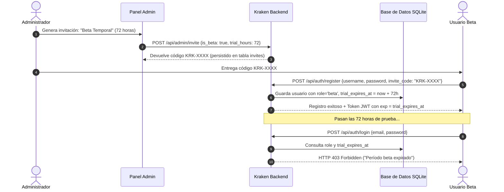
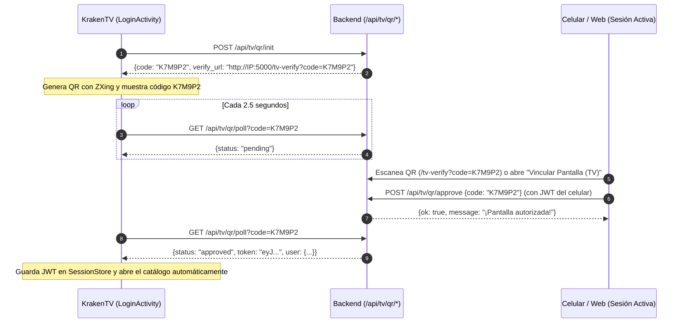

# 🐙 KRAKEN MEDIA SERVER - DOCUMENTACIÓN TÉCNICA v5.0.1
> **Fecha de Actualización:** 24 de Octubre de 2026  
> **Versión del Ecosistema:** `v5.0.1` (`v5.0.1.6` — Modular Server & Android TV Native APK)  
> **Estado:** Compilado, Verificado y Empaquetado en Producción  

---

## 1. Resumen Ejecutivo de la Versión 5.0.1

La versión **5.0.1** (iteraciones `v5.0.1` a `v5.0.1.6`) representa una evolución arquitectónica integral para el ecosistema **Kraken Media Server**, consolidando la modularización del núcleo backend, estrenando una **interfaz 100% nativa en Kotlin de alto rendimiento para Android TV (`NativeTvHomeView.kt`)**, resolviendo los límites físicos de decodificación 4K H.264 Nivel 5.1 en Smart TVs, eliminando los bloqueos de concurrencia SQLite (`database is locked`) en bibliotecas masivas (+14,400 canciones y +3,600 videos), e incorporando nuevas capas de seguridad, autenticación por QR y acceso temporal:

1. **Perfiles Beta con Expiración Temporal**: Sistema de cuentas de prueba completas con credenciales (usuario y contraseña cifrada con PBKDF2-SHA256) sujetas a un período de gracia configurable (24h, 72h, 7 días, etc.). Al caducar el período, el acceso se bloquea automáticamente por token JWT y login (`HTTP 403`).
2. **Enlaces Compartidos Seguros y Efímeros (`/share/<token>`)**: Capacidad de compartir pistas de audio con terceros mediante URLs ofuscadas de alta entropía (`secrets.token_urlsafe(16)`) de corta duración (1h a 7 días), sin exponer rutas del sistema, con aislamiento estricto contra contenido `+18`/oculto y con un reproductor web independiente con soporte de *Range Requests* (`HTTP 206`) y letras sincronizadas.
3. **Soporte de Dominio Público para Compartir**: Configuración opcional de URL externa pública (ej. `https://kraken.ederzu.com`) desde el panel de administración y asistente inicial para generar enlaces con el dominio online o automáticamente con la IP LAN (`http://192.168.x.x:5000`) si se deja en blanco.
4. **Vinculación Rápida por Código QR y Auto-Login Persistente (`/api/tv/qr/*` y `/tv-verify`)**: Inicio de sesión sin control remoto escaneando un código QR desde el celular (o ingresando el código de 6 caracteres desde el menú de perfil web `"Vincular Pantalla (TV)"`), con botón desplegable `"📲 QR Login"` en la vista web.
5. **Nueva Interfaz 100% Nativa para Android TV (`NativeTvHomeView.kt`)**: Reemplazo definitivo tanto de Leanback como del WebView pesado en Smart TVs (`isTelevision() == true`) por una arquitectura nativa en Kotlin con cuadrículas verticales infinitas de 5 columnas (`GridLayoutManager`), menú lateral retráctil en *overlay* estilo Netflix/Plex (sin desplazar el contenido), barra superior exclusiva de filtros contextuales (sin duplicar el menú lateral) y vista de detalle de películas/series con metadatos de TMDB (`MovieDetailDialog` y `SeriesDetailActivity`).
6. **Buscador en Vivo Estilo Netflix (Separado Video / Música) con Matriz Simétrica 6×6 e Insensibilidad a Acentos**: Búsqueda instantánea con debounce de 280ms que permite alternar entre **🎬 Video** y **🎵 Música**, equipada con un teclado en pantalla de matriz exacta 6×6 (`A–Z`, `0–9`, cero celdas vacías) con rutas de foco explícitas (`nextFocus*Id`) a prueba de pérdida de foco D-Pad y normalización Unicode (`NFD` / `norm_text`) que ignora tildes, diéresis y mayúsculas/minúsculas.
7. **Reproducción Adaptativa 4K H.264 Nivel 5.1 y Subtítulos Externos en Android TV (*Fantasía* 4K y *El Exorcismo de Emily Rose*)**: Detección automática de clientes TV (`client=tv`) y de pistas `video/avc` que exceden el nivel 4.1/4.2 (`> 1920x1080`) de los chips MediaTek/Amlogic de las Smart TVs, activando transcodificación HLS a 1080p acelerada por GPU (NVIDIA NVENC) con buffer de `64 MB` (`setPrioritizeTimeOverSizeThresholds(true)`) en TV, mientras preserva **4K Direct Play / Remux `-c:v copy` sin pérdida** en PC y Web.
8. **Motor SQLite en Modo `WAL` + Lazy-Loading de Carátulas con Throttling**: Eliminación total de errores `HTTP 500` y `sqlite3.OperationalError: database is locked` al cargar o hacer scroll rápido por las 14,408 canciones mediante `PRAGMA journal_mode=WAL`, eliminación del `LEFT JOIN` no indexado (reduciendo `/api/tv/music/library` de **35.85 segundos a 40 milisegundos**), semáforo concurrente `_COVER_EXTRACT_SEM`, reutilización directa de `audio_cache`, fast-path en memoria para `/status` y pausa automática de peticiones Glide durante el scroll rápido en TV.

---

## 2. Mapa Detallado de Archivos Modificados y Creados

### A. Backend del Servidor (`Kraken Media Server - modulE`)

| Archivo | Tipo de Cambio | Propósito y Función |
| :--- | :---: | :--- |
| [`services/database.py`](file:///E:/Kraken%20Media%20Server/Kraken%20Media%20Server%20-%20modulE/services/database.py) | Modificado | • Activación global de `PRAGMA journal_mode = WAL`, `PRAGMA synchronous = NORMAL` y `PRAGMA busy_timeout = 30000` (`timeout=30.0`) en `get_db_connection()`.<br>• Creación de tablas `shared_links` e `invites`, y columnas `role` y `trial_expires_at` en `users`. |
| [`services/auth.py`](file:///E:/Kraken%20Media%20Server/Kraken%20Media%20Server%20-%20modulE/services/auth.py) | Modificado | Actualización de `create_token()` para aceptar `role` y `expires_at` dinámicos en el payload JWT. |
| [`services/hls_transcoder.py`](file:///E:/Kraken%20Media%20Server/Kraken%20Media%20Server%20-%20modulE/services/hls_transcoder.py) | Modificado | • Remux 4K nativo (`-c:v copy`) para clientes Web/PC y bitrate 4K real (`20M`/`25M`) cuando requiere recodificación.<br>• En `get_playback_decision()`, detección de `is_tv_client` + resolución `> 1080p` para desactivar Direct Play en TV (`direct_play = False`) y activar `downscale_1080 = True` sin afectar a PC/Web.<br>• En `start_or_Attach_hls()`, forzado de recodificación a 1080p (`can_copy_video = False`) cuando se solicita `downscale_1080`. |
| [`routes/hls.py`](file:///E:/Kraken%20Media%20Server/Kraken%20Media%20Server%20-%20modulE/routes/hls.py) | Modificado | • Detección de cliente TV (`client=tv` o `User-Agent` con `okhttp`/`krakentv`/`dalvik`) en `/api/hls/play` y `/api/hls/reconnect`.<br>• Activación automática de `downscale_1080 = True` y `force_transcode = True` cuando una TV reproduce un archivo H.264 4K (`> 1080p` Nivel 5.1 como *Fantasía*). |
| [`routes/tv_api.py`](file:///E:/Kraken%20Media%20Server/Kraken%20Media%20Server%20-%20modulE/routes/tv_api.py) | Modificado | • Endpoints de Login QR (`/api/tv/qr/init`, `/api/tv/qr/poll`, `/api/tv/qr/approve`, `/tv-verify`).<br>• Registro de función SQLite `norm_text` (`_norm_search_text` con `unicodedata.normalize('NFD')`) para búsqueda multi-token insensible a acentos y diéresis en `/api/tv/catalog` y `/api/tv/music/library`.<br>• Optimización de `tv_music_library_page()`: eliminación del `LEFT JOIN` sin índice en el conteo de playlists (de `35.85s` a `0.04s`).<br>• Throttling y caché en `tv_music_cover()`: reutilización directa de `audio_cache`, caché negativa en memoria `_TV_NO_COVER_CACHE` y semáforo `_COVER_EXTRACT_SEM = BoundedSemaphore(4)`. |
| [`routes/api.py`](file:///E:/Kraken%20Media%20Server/Kraken%20Media%20Server%20-%20modulE/routes/api.py) | Modificado | • Gestión de invitaciones Beta, expiración de cuentas y endpoints `/api/share/*` y `/share/<token>/*`.<br>• Eliminación de los 4 `ALTER TABLE media ADD COLUMN ...` dentro de `auto_tag_library_videos()` que retenían un `EXCLUSIVE LOCK` en `kraken.db` durante varios minutos.<br>• Fast-path en memoria en `/status` (`ACTIVE_USERS`) para no abrir ni escribir en SQLite cada 2 segundos cuando el usuario ya está autenticado en sesión.<br>• Fallback en caché para `/biblioteca` y resiliencia en `/api/progress/*` ante bloqueos transitorios. |
| [`templates/share_player.html`](file:///E:/Kraken%20Media%20Server/Kraken%20Media%20Server%20-%20modulE/templates/share_player.html) | **Nuevo** | Reproductor web standalone para enlaces compartidos efímeros con diseño glassmorphic, waveform, letras sincronizadas (LRC) y pantalla de expiración (`HTTP 410`). |

---

### B. Frontend Web (`assets/js/` y `templates/`)

| Archivo | Tipo de Cambio | Propósito y Función |
| :--- | :---: | :--- |
| [`templates/index.html`](file:///E:/Kraken%20Media%20Server/Kraken%20Media%20Server%20-%20modulE/templates/index.html) | Modificado | • Modal `#share-modal` para enlaces efímeros.<br>• Botón `"Vincular Pantalla (TV)"` en el menú de perfil de todos los usuarios y modal `#tv-link-modal` para autorizar códigos QR manualmente.<br>• En el modal de login web, el código QR ahora está oculto por defecto y se despliega bajo demanda mediante el botón `"📲 QR Login"`. |
| [`assets/js/auth.js`](file:///E:/Kraken%20Media%20Server/Kraken%20Media%20Server%20-%20modulE/assets/js/auth.js) | Modificado | • Función `toggleWebLoginQr()` para iniciar el polling QR en WebView únicamente cuando el usuario pulsa `"📲 QR Login"`.<br>• Funciones `openTvLinkModal()`, `closeTvLinkModal()` y `submitTvLinkCode()` para vincular pantallas desde cualquier sesión activa.<br>• Soporte de perfiles `BETA` en el selector de bienvenida. |
| [`assets/js/admin-settings.js`](file:///E:/Kraken%20Media%20Server/Kraken%20Media%20Server%20-%20modulE/assets/js/admin-settings.js) | Modificado | • Selector de invitaciones Beta temporales, badges de rol (`ADMIN`, `BETA`, `BETA EXPIRADO`), modal `adminOpenRoleModal` y configuración de URL Pública con preservación del JSON `kraken_user` en `localStorage`. |
| [`assets/js/state.js`](file:///E:/Kraken%20Media%20Server/Kraken%20Media%20Server%20-%20modulE/assets/js/state.js) | Modificado | Vinculación bidireccional de `window.currentPath` y `window.currentFolderView` con `Object.defineProperty` para corregir la apertura de series con apóstrofes (ej. *El Show de los 70's*). |
| [`assets/js/hero_series.js`](file:///E:/Kraken%20Media%20Server/Kraken%20Media%20Server%20-%20modulE/assets/js/hero_series.js), [`video-catalog.js`](file:///E:/Kraken%20Media%20Server/Kraken%20Media%20Server%20-%20modulE/assets/js/video-catalog.js), [`library-render.js`](file:///E:/Kraken%20Media%20Server/Kraken%20Media%20Server%20-%20modulE/assets/js/library-render.js) | Modificado | Migración de manejadores inline vulnerables a atributos HTML5 sanitizados (`data-path`, `data-season`) y vista de detalle TMDB enriquecida. |
| [`assets/js/lyrics-share.js`](file:///E:/Kraken%20Media%20Server/Kraken%20Media%20Server%20-%20modulE/assets/js/lyrics-share.js) y [`radar-remote.js`](file:///E:/Kraken%20Media%20Server/Kraken%20Media%20Server%20-%20modulE/assets/js/radar-remote.js) | Modificado | Controladores de enlaces compartidos y aislamiento de privacidad por cuenta (`isMyAccount`) en Radar y Segunda Pantalla. |

---

### C. Aplicación Android TV & Mobile (`KrakenTV`)

| Archivo | Tipo de Cambio | Propósito y Función |
| :--- | :---: | :--- |
| [`NativeTvHomeView.kt`](file:///E:/Kraken%20Media%20Server/KrakenTV/app/src/main/java/com/kraken/tv/NativeTvHomeView.kt) | **Nuevo / Reescrito** | **Motor 100% Nativo en Kotlin para Android TV (`NativeTvHomeController`)**:<br>• Cuadrícula vertical infinita de 5 columnas (`GridLayoutManager`) para Video y Música (+14,408 canciones con paginación automática `limit=30`).<br>• Menú lateral izquierdo retráctil en *overlay* (`FrameLayout` con `elevation=20dp`) que nunca empuja ni encoge el área principal.<br>• Barra superior contextual (ordenamiento `A-Z`, `Año`, `Aleatorio`, `Maratón` + píldoras de Género en Video; Géneros musicales + Carpetas en Música) sin clonar el menú lateral.<br>• Buscador en vivo estilo Netflix (`buildNetflixSearchPanel()`) separado para Video y Música con teclado matricial 6×6 a prueba de pérdida de foco y normalización sin acentos.<br>• Pausa/reanudación automática de Glide durante scroll rápido (`SCROLL_STATE_SETTLING`) y caché en disco `RGB_565` (`160x160` / `185x278`).<br>• Diálogo nativo de detalle de películas (`MovieDetailDialog`) con metadatos de TMDB, selector de idioma/pista de audio y resumen de progreso. |
| [`MainActivity.kt`](file:///E:/Kraken%20Media%20Server/KrakenTV/app/src/main/java/com/kraken/tv/MainActivity.kt) | Modificado | • Detección inteligente de dispositivo (`isTelevision()`): lanza `NativeTvHomeController` en Smart TVs / TV Boxes para rendimiento nativo a 60fps, y conserva el `WebView` híbrido en teléfonos y tablets.<br>• Delegación limpia de la tecla `BACK` (`handleBackPress()`) para cerrar el buscador o colapsar el menú lateral antes de salir. |
| [`LoginActivity.kt`](file:///E:/Kraken%20Media%20Server/KrakenTV/app/src/main/java/com/kraken/tv/LoginActivity.kt) | Modificado | Pantalla de bienvenida dividida en 2 paneles: **Panel Izquierdo con Código QR en vivo** (generado nativamente con `com.google.zxing:core:3.5.3` + polling automático cada 2.5s a `/api/tv/qr/poll`) y **Panel Derecho con Login Clásico** para control remoto. |
| [`KrakenApi.kt`](file:///E:/Kraken%20Media%20Server/KrakenTV/app/src/main/java/com/kraken/tv/KrakenApi.kt) | Modificado | • Codificación segura por segmento (`HttpUrl.Builder.addPathSegment()`) en `resolve()` para rutas y subtítulos con espacios, acentos y paréntesis.<br>• Inclusión del parámetro `client=tv` en `startPlayback()` y `startPlaybackByPath()`.<br>• Modelos y métodos para QR Login (`initQrLogin`, `pollQrLogin`) y biblioteca musical paginada (`fetchMusicLibraryPage` con `limit = 30`). |
| [`PlayerActivity.kt`](file:///E:/Kraken%20Media%20Server/KrakenTV/app/src/main/java/com/kraken/tv/PlayerActivity.kt) | Modificado | • Configuración de `DefaultLoadControl` con buffer de **64 MB** y `setPrioritizeTimeOverSizeThresholds(true)` para evitar atascos en picos de bitrate.<br>• Desactivación de decodificador por software (`setEnableDecoderFallback(false)`) en `DefaultRenderersFactory`.<br>• Detector proactivo en `onTracksChanged`: si una pista `video/avc` (H.264) supera `1920x1080` en reproducción directa o remux, conmuta en el acto a transcodificación HLS 1080p.<br>• Rescate universal en `onPlayerError` que reintenta sin subtítulos externos (`subtitles = emptyList()`) y con `forceTranscode = true` (`downscale_1080 = 1`). |
| [`SeriesDetailActivity.kt`](file:///E:/Kraken%20Media%20Server/KrakenTV/app/src/main/java/com/kraken/tv/SeriesDetailActivity.kt) | Modificado | Vista nativa de series con backdrop TMDB, botón *"Continuar viendo T1:E3"*, botón *"Episodio Aleatorio"*, selector de temporadas y riel 16:9 con navegación D-Pad sin trampas de foco. |

---

## 3. Funcionamiento Técnico Detallado de las Mejoras y Reparaciones

### 3.1. Perfiles Beta con Expiración Temporal
Permite que usuarios invitados prueben Kraken con una cuenta real (usuario y contraseña), pero con caducidad automática en el tiempo establecido:



* **Persistencia en SQLite (`invites`)**: Los códigos se almacenan en la tabla `invites` para sobrevivir reinicios del servidor y solo se marcan como usados (`used_at`) tras validar que el nombre de usuario no exista previamente (`HTTP 409`).
* **Renovación en Vivo**: El administrador puede otorgar prórrogas (+24h, +3d, +7d) o convertir la cuenta en permanente desde `PUT /api/admin/users/<email>/role`.

---

### 3.2. Enlaces Compartidos Seguros y Efímeros (`/share/<token>`)
Permite compartir canciones puntuales mediante un enlace limpio sin comprometer credenciales ni exponer la biblioteca:
* **Token Criptográfico Opaco**: 128 bits de entropía (`secrets.token_urlsafe(16)`), enmascarado en los logs del servidor (`token[:4] + '...' + token[-4:]`).
* **Restricción de Seguridad y Privacidad**: Limitado exclusivamente a pistas de audio (`media_type == 'audio'`), bloqueando videos (`HTTP 400`) y contenido clasificado como adulto (`is_adult = 1`) u oculto (`is_hidden = 1`) con `HTTP 403 Forbidden`. Duración validada en servidor entre $1.0 \le \text{horas} \le 168.0$ (máximo 7 días).
* **Expiración Unánime (`HTTP 410 Gone`)**: Al vencer el plazo, `/share/<token>`, `/share/<token>/stream`, `/share/<token>/cover` y `/share/<token>/lyrics` responden con `HTTP 410 Gone`.

---

### 3.3. Configuración de Dominio Público y Fallback Automático a IP Local
* **Doble Interfaz**: Configurable tanto en Ajustes de Administrador (`admin-settings.js`) como en el Asistente Inicial (`showFirstTimeSetup`), acompañado de un botón de ayuda `(?)` que explica que es **100% opcional** (para usuarios con Cloudflare Tunnel, Tailscale o dominio propio).
* **Comportamiento Inteligente**: Si se configura `https://kraken.ederzu.com`, los enlaces compartidos usan el dominio público; si se deja en blanco (`PUBLIC_SERVER_URL = ''`), Kraken genera los enlaces usando automáticamente la IP LAN del servidor (`http://192.168.x.x:5000/share/<token>`).

---

### 3.4. Rediseño de Series y Episodios en Android TV (`SeriesDetailActivity.kt`)
* Se reemplazó el antiguo `AlertDialog` por [`SeriesDetailActivity.kt`](file:///E:/Kraken%20Media%20Server/KrakenTV/app/src/main/java/com/kraken/tv/SeriesDetailActivity.kt) a pantalla completa con backdrop TMDB, calificación ⭐, sinopsis, botón principal **`▶ Continuar viendo T1:E3`** (calculado al segundo exacto por el servidor), botón **`🎲 Episodio Aleatorio`**, selector horizontal de temporadas y tarjetas de episodios panorámicas 16:9 (`250dp x 140dp`) servidas desde `/api/tv/thumbnail/...` con barra de progreso esmeralda y badge `✓ Visto`.

---

### 3.5. Privacidad de Dispositivos, Identidad en `/status` y Sanitización DOM
1. **Aislamiento de Segunda Pantalla y Radar ([`radar-remote.js`](file:///E:/Kraken%20Media%20Server/Kraken%20Media%20Server%20-%20modulE/assets/js/radar-remote.js) y [`routes/api.py`](file:///E:/Kraken%20Media%20Server/Kraken%20Media%20Server%20-%20modulE/routes/api.py))**:
   * El aviso *"🟢 VIENDO EN PANTALLA Kraken TV ¿Deseas usar este celular como segunda pantalla?"* y los endpoints `/control` y `/device/control/link` exigen coincidencia estricta de cuenta (`isMyAccount` / mismo email o SuperAdmin), impidiendo que usuarios externos vean o controlen pantallas ajenas.
2. **Autenticación Limpia en `/status`**:
   * Se corrigió la llamada a `window.krakenAuth.headers()` en `app-init.js` y se eliminó la promoción indebida de invitados a SuperAdmin en `routes/api.py`.
3. **Corrección Definitiva de Series con Apóstrofes (*El Show de los 70's*)**:
   * Se migraron los manejadores `onclick` inline a atributos `data-path` sanitizados y se enlazaron `window.currentPath` y `window.currentFolderView` con `Object.defineProperty` en [`assets/js/state.js`](file:///E:/Kraken%20Media%20Server/Kraken%20Media%20Server%20-%20modulE/assets/js/state.js).

---

### 3.6. Login por Código QR, Auto-Login Persistente y Vinculación de Pantallas (`v5.0.1.4` – `v5.0.1.6`)



1. **En la App Nativa de TV ([`LoginActivity.kt`](file:///E:/Kraken%20Media%20Server/KrakenTV/app/src/main/java/com/kraken/tv/LoginActivity.kt))**:
   * Muestra de forma predeterminada el panel de vinculación por QR a la izquierda (generado localmente en un `ImageView` con `ZXing` sin depender de internet) junto al código de 6 caracteres (`XXX - XXX`), y el formulario tradicional a la derecha.
   * Una vez autorizada la pantalla, el JWT queda guardado de forma persistente en `SessionStore` (`SharedPreferences`), entrando directo al catálogo en todos los arranques futuros (**Auto-Login**).
2. **En la Interfaz Web ([`templates/index.html`](file:///E:/Kraken%20Media%20Server/Kraken%20Media%20Server%20-%20modulE/templates/index.html) y [`assets/js/auth.js`](file:///E:/Kraken%20Media%20Server/Kraken%20Media%20Server%20-%20modulE/assets/js/auth.js))**:
   * **Botón Desplegable `"📲 QR Login"`**: Para no saturar el modal de inicio de sesión en navegadores de PC o móvil, el código QR permanece oculto y solo se inicializa y hace polling cuando el usuario pulsa el botón **`📲 QR Login`**.
   * **Opción `"Vincular Pantalla (TV)"` para Todos los Usuarios**: En el menú desplegable de perfil (esquina superior derecha), todos los usuarios cuentan con la opción **"Vincular Pantalla (TV)"**, que abre un modal donde pueden escribir el código de 6 letras que aparece en su televisor para prestarle su sesión al instante.

---

### 3.7. Nueva Interfaz 100% Nativa para Android TV (`NativeTvHomeView.kt`)

#### ¿Por qué se descartaron tanto Leanback como el WebView en Smart TVs?
1. **El problema del WebView en Smart TVs**: La interfaz web utiliza efectos intensivos de CSS como `backdrop-filter: blur()`, sombras difuminadas, animaciones continuas y cientos de nodos DOM con imágenes en resolución original RGBA de 32 bits. Mientras que en una PC o celular moderno fluye sin esfuerzo, el chip gráfico (GPU) de una Smart TV se ahogaba al recalcular el desenfoque en cada pulsación del control remoto.
2. **El problema del antiguo `BrowseFragment.kt` (Leanback)**: Leanback estaba diseñado para rieles horizontales limitados y obligaba a partir la biblioteca en filas falsas de `ImageCardView` con cajas grises truncadas, y en la sección de música truncaba las listas a 540 elementos en scroll horizontal cuando la biblioteca real supera las **14,408 canciones**.

#### Arquitectura de `NativeTvHomeController` ([`NativeTvHomeView.kt`](file:///E:/Kraken%20Media%20Server/KrakenTV/app/src/main/java/com/kraken/tv/NativeTvHomeView.kt)):
* **Detección Automática en [`MainActivity.kt`](file:///E:/Kraken%20Media%20Server/KrakenTV/app/src/main/java/com/kraken/tv/MainActivity.kt)**:
  * Si el dispositivo es un televisor (`isTelevision() == true`), carga la interfaz 100% nativa en Kotlin (`NativeTvHomeController`).
  * Si es un celular o tablet (`isTelevision() == false`), conserva el `WebView` táctil completo.
* **Cuadrícula Vertical Infinita de 5 Columnas (`GridLayoutManager`)**:
  * Tanto el catálogo de **Video** como el de **Mi Música** se despliegan hacia abajo en una cuadrícula vertical de 5 columnas con scroll fluido a 60fps.
  * En **Mi Música → Todas las canciones**, el `RecyclerView` pagina automáticamente de 30 en 30 a medida que el usuario baja (`maybeLoadMoreMusicPage()`), permitiendo recorrer las **14,408 canciones** completas sin truncamiento y mostrando el contador real en vivo.
* **Menú Lateral Izquierdo Desplegable en Overlay (Estilo Netflix / Plex)**:
  * Construido sobre un `FrameLayout` raíz donde la barra lateral (`sidebarContainer`) flota en *overlay* con `elevation = dp(20)` sobre el margen izquierdo (`76dp` colapsada mostrando solo iconos; `256dp` expandida con etiquetas y descripciones).
  * **Cero desplazamiento de layout**: Al abrirse o cerrarse automáticamente cuando el foco entra o sale del menú lateral, el contenedor principal **nunca se empuja ni cambia de ancho**, evitando saltos visuales o pérdida de foco.
  * Contiene las vistas principales de navegación:
    * **Video**: `🏠 Inicio`, `🎬 Películas`, `📺 Series`, `▶️ Seguir viendo`, `🔥 Descubre hoy`.
    * **Música**: `🎵 Todas las canciones`, `✨ Mixes Para Ti`, `📋 Tus Playlists`, `💿 Álbumes`, `🎤 Artistas`.
    * **Acciones**: `🔍 Buscar`, `🔄 Actualizar`, `🚪 Cerrar sesión`.
* **Barra Superior Exclusiva de Filtros Contextuales (Sin Clonar el Menú Lateral)**:
  * Se eliminaron de la barra superior los botones que repetían las secciones del menú lateral.
  * Ahora la barra superior muestra únicamente **filtros y ordenamientos contextuales**:
    * **En Video**: Píldoras de orden (`🔤 A-Z`, `📅 Año`, `🎲 Aleatorio`, `🏃 Maratón`) seguidas de las **píldoras horizontales directas de Género** (`Todos los géneros`, `Acción`, `Animación`, `Ciencia ficción`, `Terror`, etc.).
    * **En Música**: Botón selector `🎷 Género musical` + píldoras horizontales de **Carpetas / Categorías musicales**.
* **Tarjetas Visuales con Estética Kraken Web (`#070A12`)**:
  * **Pósters de Video (2:3)**: Bordes redondeados, badge de tipo (`SERIE` en azul `#0EA5E9` / `PELI`), badge de año, calificación `★ TMDB`, barra de progreso verde esmeralda (`#10B981`) en la base y anillo de enfoque esmeralda con zoom suave (`1.05x`).
  * **Tarjetas de Música y Mixes**: Pistas con carátula cuadrada a la izquierda (`64dp`), título, artista, álbum y badge de carpeta en esmeralda; tarjetas de **Mixes Para Ti** con degradados vibrantes personalizados (Esmeralda para *Mis Favoritos*, Índigo/Morado para *Para Ti Hoy*, Azul profundo para *Chill & Noche*, Ámbar/Rojo para *Energía Total*).
* **Diálogo Nativo de Detalle de Película (`MovieDetailDialog`)**:
  * Al seleccionar una película, se abre una vista de detalle estilo TMDB con póster, backdrop, año, duración, calificación, sinopsis completa, selector de pista de audio/idioma integrado y botones **`▶ Reproducir`** / **`⏩ Continuar desde MM:SS`**.

---

### 3.8. Buscador en Vivo Estilo Netflix (Separado Video / Música) con Matriz 6×6 e Insensibilidad a Acentos

1. **Separación Clara Video vs. Música y Actualización en Vivo**:
   * Al abrir `🔍 Buscar` en el menú lateral, el usuario puede conmutar entre **`🎬 Buscar en Video`** y **`🎵 Buscar en Música`**.
   * Cada letra pulsada actualiza los resultados en vivo en la cuadrícula derecha con un debounce de `280ms` (sin necesidad de pulsar un botón de enviar).
2. **Teclado en Pantalla Simétrico 6×6 a Prueba de Pérdida de Foco (`buildNetflixSearchPanel()`)**:
   * **Causa del bug previo**: El teclado anterior tenía un cuadro de texto superior enfocable sin salida clara, una fila de 4 botones de acción conectada a una cuadrícula de 6 columnas donde la última fila solo tenía 2 teclas (`9` y `0`) y 4 celdas vacías. Cuando el usuario bajaba con el D-Pad desde las columnas 3 a 6 de la penúltima fila, Android TV no encontraba vista debajo y el foco escapaba hacia el menú lateral o desaparecía.
   * **Solución definitiva**:
     * El cuadro superior que muestra el texto escrito (`searchDisplayBox`) ahora es estrictamente visual (`isFocusable = false`), impidiendo que el foco quede atrapado arriba.
     * La matriz alfanumérica (`A–Z` y `0–9`, 36 teclas exactas) se organizó en una **cuadrícula perfecta de 6×6 sin una sola celda vacía** (`A-F`, `G-L`, `M-R`, `S-X`, `Y, Z, 1, 2, 3, 4`, `5, 6, 7, 8, 9, 0`).
     * Cada botón de modo (`🎬 Video`, `🎵 Música`), cada botón de acción (`␣ Espacio`, `⌫ Borrar`, `🗑 Limpiar`, `Ñ`) y cada una de las 36 teclas tiene asignados explícitamente sus 4 vecinos cardinales (`nextFocusUpId`, `nextFocusDownId`, `nextFocusLeftId`, `nextFocusRightId`), haciendo físicamente imposible que el foco se pierda al moverse rápido con el control remoto.
3. **Búsqueda Insensible a Acentos, Diéresis y Puntuación (`norm_text`)**:
   * **En Android TV ([`NativeTvHomeView.kt`](file:///E:/Kraken%20Media%20Server/KrakenTV/app/src/main/java/com/kraken/tv/NativeTvHomeView.kt))**: Función `normText()` basada en `java.text.Normalizer.normalize(s, Normalizer.Form.NFD)` que elimina marcas diacríticas (`\p{InCombiningDiacriticalMarks}+`), convierte `ñ -> n` y divide la consulta en tokens independientes.
   * **En el Servidor SQLite ([`routes/tv_api.py`](file:///E:/Kraken%20Media%20Server/Kraken%20Media%20Server%20-%20modulE/routes/tv_api.py))**: Se registró la función SQLite personalizada `conn.create_function("norm_text", 1, _norm_search_text)` en `get_tv_db()`. Tanto `/api/tv/catalog` como `/api/tv/music/library` evalúan cada palabra buscada con `norm_text(...) LIKE ?`.
   * **Resultado**: Escribir `fantasia` encuentra **Fantasía (1940)**; escribir ` nino ` o `exorcismo emily` encuentra resultados aunque tengan tildes, mayúsculas o palabras intermedias.

---

### 3.9. Solución Definitiva a Películas 4K H.264 Nivel 5.1 (*Fantasía*) y Subtítulos Externos (*El Exorcismo de Emily Rose*) en Smart TVs

#### Diagnóstico Forense de *Fantasía (1940)* (`id = 1141828`):
Al inspeccionar el archivo `Fantasía (1940) - (tmdb-756).mp4` con `ffprobe`, se identificó por qué fallaba en la TV mientras otros videos sí abrían:
* **Códec y Nivel**: `h264 (High), level 5.1`, resolución **`2872x2160` (4K UHD)**, contenedor `.mp4` con audio `AAC` estéreo.
* **Por qué fallaba en la Smart TV**:
  1. Al ser `.mp4` con `H.264 + AAC`, el servidor asumía que era compatible con **Direct Play** y enviaba el archivo 4K original sin transcodificar (`/stream/1141828?direct=1`).
  2. En los chips de Android TV (MediaTek / Amlogic / Realtek), el decodificador de hardware para **H.264 (`OMX.*.video.decoder.avc` / `c2.mtk.avc.decoder`) soporta como máximo Nivel 4.1 / 4.2 (`1920x1080`)** (solo el decodificador HEVC/H.265 soporta 4K en esas TVs).
  3. Como `PlayerActivity.kt` tenía `setEnableDecoderFallback(true)`, cuando el chip de hardware rechazaba el stream H.264 4K Nivel 5.1, ExoPlayer no lanzaba error para pedir HLS 1080p, sino que intentaba decodificar `2872x2160` en el **decodificador por software (`c2.android.avc.decoder`)** en la CPU de la TV, llenando además el pequeño buffer de `16 MB` con `setPrioritizeTimeOverSizeThresholds(false)` y congelando el reproductor en el primer segundo.

#### Triple Blindaje Implementado:
1. **Detección Proactiva de TV en Backend ([`routes/hls.py`](file:///E:/Kraken%20Media%20Server/Kraken%20Media%20Server%20-%20modulE/routes/hls.py) y [`services/hls_transcoder.py`](file:///E:/Kraken%20Media%20Server/Kraken%20Media%20Server%20-%20modulE/services/hls_transcoder.py))**:
   * [`KrakenApi.kt`](file:///E:/Kraken%20Media%20Server/KrakenTV/app/src/main/java/com/kraken/tv/KrakenApi.kt) envía siempre `client=tv` en `/api/hls/play`.
   * Cuando el servidor detecta `is_tv_client` y el video supera `1080p` (`width > 1920` o `height > 1080`), desactiva Direct Play (`direct_play = False`), activa `downscale_1080 = True` y, si el códec es `h264`, activa `force_transcode = True` desde el primer instante para que NVIDIA NVENC entregue un stream HLS `1440x1080` Nivel 4.1 fluido a la TV.
   * **Cero impacto en PC/Web**: En navegadores de PC y móvil (`is_tv_client == False`), *Fantasía* y cualquier otro video 4K siguen reproduciéndose en **4K nativo Direct Play / Remux `-c:v copy`**.
2. **Detector de Pistas `video/avc > 1080p` y Buffer de 64 MB en [`PlayerActivity.kt`](file:///E:/Kraken%20Media%20Server/KrakenTV/app/src/main/java/com/kraken/tv/PlayerActivity.kt)**:
   * Se aumentó `DefaultLoadControl` de `16 MB` a **`64 MB`** y se activó `setPrioritizeTimeOverSizeThresholds(true)` para que ningún pico de bitrate bloquee el buffer de ExoPlayer.
   * Se estableció `setEnableDecoderFallback(false)` para impedir que la TV caiga silenciosamente en decodificación por software lenta.
   * En `onTracksChanged`, si ExoPlayer detecta una pista `video/avc` con `width > 1920` o `height > 1080` sin transcodificar, solicita automáticamente al servidor el stream HLS reescalado a 1080p antes de que se congele la imagen.
3. **Rescate Limpio ante Subtítulos Externos Dañados (*El Exorcismo de Emily Rose*)**:
   * Las URLs de subtítulos `.srt` con espacios y paréntesis se codifican por segmento con `HttpUrl.Builder.addPathSegment()` en [`KrakenApi.kt`](file:///E:/Kraken%20Media%20Server/KrakenTV/app/src/main/java/com/kraken/tv/KrakenApi.kt).
   * Si un archivo `.srt` externo falla o el contenedor MKV lanza error en `onPlayerError`, el fallback en [`PlayerActivity.kt`](file:///E:/Kraken%20Media%20Server/KrakenTV/app/src/main/java/com/kraken/tv/PlayerActivity.kt) limpia los subtítulos externos (`playback.copy(subtitles = emptyList())`) y relanza el stream HLS de inmediato.

---

### 3.10. Eliminación de Bloqueos SQLite (`database is locked` / Error 500) y Lazy-Loading de Carátulas Musicales (`v5.0.1.6`)

#### Diagnóstico de las 3 Causas que Provocaban el Error 500 y Bloqueo de `kraken.db`:
1. **Consulta de 35.85 Segundos en `/api/tv/music/library` ([`routes/tv_api.py`](file:///E:/Kraken%20Media%20Server/Kraken%20Media%20Server%20-%20modulE/routes/tv_api.py))**:
   * En la primera página (`offset == 0`), `tv_music_library_page()` calculaba las playlists ejecutando:
     ```sql
     LEFT JOIN media m ON replace(m.rel_path, '\', '/') = replace(pi.rel_path, '\', '/')
     ```
   * Al aplicar `replace()` sobre ambos lados del `JOIN`, SQLite no podía utilizar ningún índice y realizaba un producto cartesiano entre las **18,082 filas de `media`** y los **1,170 ítems de `playlist_items`**, tardando **35.85 segundos** con la CPU al 100%.
2. **Bloqueo Exclusivo (`EXCLUSIVE LOCK`) en `auto_tag_library_videos()` + `journal_mode = DELETE`**:
   * La base de datos `kraken.db` operaba en modo `DELETE` con timeout por defecto de 5 segundos.
   * Al iniciar el servidor, el hilo en segundo plano `auto_tag_library_videos()` ejecutaba 4 sentencias `ALTER TABLE media ADD COLUMN ...` al comienzo de su transacción y luego permanecía varios minutos consultando TMDB y FFmpeg sin hacer `commit()`, manteniendo un bloqueo exclusivo sobre `kraken.db`.
   * Mientras tanto, `/status` intentaba hacer `UPDATE users SET sid = ?` cada 2 segundos y agotaba los 5 segundos de espera, lanzando `sqlite3.OperationalError: database is locked` en `/biblioteca` y `/api/tv/music/library`.
3. **Avalancha de Extracción de Carátulas Embebidas en Scroll Rápido**:
   * Al hacer scroll rápido por las 14,408 canciones, la TV disparaba decenas de peticiones simultáneas a `/api/tv/music/cover/<id>`, abriendo decenas de archivos MP3/FLAC a la vez con Mutagen y recomprimiendo imágenes con Pillow aunque ya existieran en `audio_cache`.

#### Solución Integral Implementada:
1. **Migración de SQLite a `WAL` (`Write-Ahead Logging`) y Timeout de 30s ([`services/database.py`](file:///E:/Kraken%20Media%20Server/Kraken%20Media%20Server%20-%20modulE/services/database.py))**:
   * `get_db_connection()` establece `timeout=30.0`, `PRAGMA journal_mode = WAL`, `PRAGMA synchronous = NORMAL` y `PRAGMA busy_timeout = 30000`. En modo `WAL`, los lectores jamás bloquean a los escritores ni los escritores bloquean a los lectores.
2. **Optimización de `/api/tv/music/library` de `35.85s` a `0.04s` ([`routes/tv_api.py`](file:///E:/Kraken%20Media%20Server/Kraken%20Media%20Server%20-%20modulE/routes/tv_api.py))**:
   * Se reemplazó el `LEFT JOIN` por consultas directas indexadas sobre `playlist_items` (`COUNT(pi.id)`), reduciendo el tiempo total de respuesta de **35,850 ms a ~40 ms** (casi 900 veces más rápido).
3. **Eliminación del Lock en `auto_tag_library_videos()` y Fast-Path en `/status` ([`routes/api.py`](file:///E:/Kraken%20Media%20Server/Kraken%20Media%20Server%20-%20modulE/routes/api.py))**:
   * Se eliminaron los `ALTER TABLE` redundantes dentro de `auto_tag_library_videos()` (las columnas ya se crean en `init_db()`).
   * En `/status`, si el usuario ya está autenticado en `ACTIVE_USERS`, sus datos se resuelven directamente en RAM sin abrir ni escribir en SQLite cada 2 segundos.
   * `/biblioteca` devuelve instantáneamente `_BIBLIOTECA_MEM_CACHE` si detecta cualquier bloqueo transitorio en lugar de devolver `HTTP 500`.
4. **Lazy-Loading y Throttling de Carátulas en Servidor y TV ([`routes/tv_api.py`](file:///E:/Kraken%20Media%20Server/Kraken%20Media%20Server%20-%20modulE/routes/tv_api.py) y [`NativeTvHomeView.kt`](file:///E:/Kraken%20Media%20Server/KrakenTV/app/src/main/java/com/kraken/tv/NativeTvHomeView.kt))**:
   * **Reutilización Directa de `audio_cache`**: Si la carátula ya fue extraída previamente en `audio_cache/<md5>.jpg`, `/api/tv/music/cover/<id>` la sirve de inmediato sin abrir el MP3 ni recodificarla con Pillow.
   * **Semáforo `_COVER_EXTRACT_SEM = BoundedSemaphore(4)` y `_TV_NO_COVER_CACHE`**: Limita a un máximo de 4 extracciones pesadas simultáneas en disco y recuerda en RAM qué pistas no tienen carátula para no volver a escanearlas.
   * **Pausa de Glide en Scroll Rápido en TV**: `NativeTvHomeView.kt` pausa las descargas de imágenes (`Glide.with(activity).pauseRequests()`) mientras la lista se desplaza por inercia (`SCROLL_STATE_SETTLING`) y las reanuda al detenerse (`resumeRequests()`), usando `DiskCacheStrategy.ALL`, formato `RGB_565` a `160x160` y lotes de `limit = 30`.

---

### 3.11. Integridad de Cuentas de Usuario y Base de Datos

Se verificó la integridad del motor SQLite de producción en `D:\Skazo\Music\Kraken Media\kraken.db`:
* **Usuarios Legítimos Preservados al 100%**:
  1. `arsdaemonia@gmail.com` — Alias: **Skaso** (SuperAdmin con acceso maestro).
  2. `nico@kraken.local` — Alias: **Nico** (Cuenta regular activa).
  3. `denki@kraken.local` — Alias: **Denki** (Cuenta regular activa).
  4. `sol@kraken.local` — Alias: **Sol** (Cuenta regular activa).
* **Contraseñas y Datos Intactos**: Todos los hashes criptográficos PBKDF2, listas de reproducción, progreso de visualización y configuraciones personales permanecieron intactos.

---

### 3.12. Compilación y Empaquetado Final de Binarios Windows (`v5.0.1.6`)

Tras la validación de todas las pruebas funcionales, la optimización de la base de datos y la estabilización de la nueva interfaz de Android TV, se levantó la moratoria de empaquetado y se procedió a compilar la totalidad de los binarios ejecutables para Windows:
1. **`KrakenOffline.exe`**: Compilado mediante PyInstaller (`KrakenOffline.spec`) con soporte de PyWebView, túneles offline, todas las rutas del backend modular y dependencias multimedia.
2. **`Kraken.exe`**: Compilado mediante PyInstaller (`Kraken.spec`) como servidor standalone de consola.
3. **`Kraken_Media_Server_Installer_v5.0.1.exe`**: Generado con Inno Setup Compiler (`ISCC.exe` sobre `kraken_installer_safe.iss`), empaquetando el entorno de producción completo en un instalador nativo ligero y seguro.

---

### 3.13. Reparación de Reproductor de Audio, Control Remoto de Películas (Cine Remote) y "Seguir Viendo" Instantáneo en HLS (`v5.0.1.7`)

Se resolvieron tres problemas clave de experiencia de reproducción y control multimonitor en Web, Móvil y Android TV:

1. **Estabilidad del Reproductor de Audio e Historial Real para "Canción Anterior" ([`assets/js/audio-player.js`](file:///E:/Kraken%20Media%20Server/Kraken%20Media%20Server%20-%20modulE/assets/js/audio-player.js) y [`PlayerQueue.kt`](file:///E:/Kraken%20Media%20Server/KrakenTV/app/src/main/java/com/kraken/tv/PlayerQueue.kt))**:
   * **Fin de bloqueos en Play/Pausa y Crossfade**: Se eliminó `currAudio.src = ""` (que hacía que el navegador intentara cargar la página HTML actual como archivo de audio y lanzara `MEDIA_ERR_SRC_NOT_SUPPORTED`) reemplazándolo por `removeAttribute('src')` + `load()`. Se cancela cualquier `setTimeout` de crossfade pendiente (`window._crossfadeCleanupTimer`) al cambiar de pista o pausar, se restaura `gainNode.gain.setValueAtTime(1, now)` y `audioCtx.resume()` en `togglePlay()`, y nunca se deja `#player-bar` bloqueado con `pointerEvents = 'none'`.
   * **Botón "Anterior" con Historial Real (`window.audioPlayHistory` y `PlayerQueue.history`)**: Al tocar una canción con `playNow()`, ahora se construye una cola contextual (álbum, artista, carpeta o vista actual) en lugar de una cola de 1 sola canción que disparaba de inmediato `activarModoRadio()`. Además, tanto en Web (`window.audioPlayHistory`) como en Android TV (`PlayerQueue.history`), se guarda una pila real de las canciones reproducidas para que el botón "Anterior" siempre regrese exactamente a la última canción escuchada.

2. **Sincronización de Avance y Seek en `Kraken Cine Remote` ([`assets/js/radar-remote.js`](file:///E:/Kraken%20Media%20Server/Kraken%20Media%20Server%20-%20modulE/assets/js/radar-remote.js), [`assets/js/app-init.js`](file:///E:/Kraken%20Media%20Server/Kraken%20Media%20Server%20-%20modulE/assets/js/app-init.js) y [`PlayerActivity.kt`](file:///E:/Kraken%20Media%20Server/KrakenTV/app/src/main/java/com/kraken/tv/PlayerActivity.kt))**:
   * **Persistencia del Dispositivo Controlado**: Se corrigió `app-init.js` para que el latido `/status` no borre `window.KRAKEN_CONTROL_TARGET` cuando hay una sesión activa en `window.KRAKEN_PLAYBACK_TARGET` o `window._activeCineRemoteData`, y `sendCommand()` / `sendRemoteSeek()` ahora resuelven automáticamente el `session_id` desde cualquiera de los tres punteros activos.
   * **Resolución de Duración Real y Ventana de Gracia en el Slider**: Se añadió `resolveMediaDurationSeconds()` (que convierte cadenas `"H:MM:SS"` o `"MM:SS"` de la biblioteca a segundos numéricos y asigna un `max` dinámico si el stream HLS aún no reporta duración total) y una ventana de gracia de 4.5 segundos (`window._lastRemoteSeekAt` / `window._lastRemoteSeekTargetTime`) para que el polling cada 2 segundos no regrese la barra de progreso a la posición vieja ni anule toques rápidos seguidos en `+10s` / `-10s` / `+30s` / `-30s`.

3. **"Seguir Viendo" (Resume) Instantáneo y Seek Server-Side en HLS ([`services/hls_transcoder.py`](file:///E:/Kraken%20Media%20Server/Kraken%20Media%20Server%20-%20modulE/services/hls_transcoder.py), [`routes/hls.py`](file:///E:/Kraken%20Media%20Server/Kraken%20Media%20Server%20-%20modulE/routes/hls.py), [`routes/api.py`](file:///E:/Kraken%20Media%20Server/Kraken%20Media%20Server%20-%20modulE/routes/api.py), [`assets/js/video-player.js`](file:///E:/Kraken%20Media%20Server/Kraken%20Media%20Server%20-%20modulE/assets/js/video-player.js), [`assets/js/hero_series.js`](file:///E:/Kraken%20Media%20Server/Kraken%20Media%20Server%20-%20modulE/assets/js/hero_series.js) y [`PlayerActivity.kt`](file:///E:/Kraken%20Media%20Server/KrakenTV/app/src/main/java/com/kraken/tv/PlayerActivity.kt))**:
   * **Direct Play desbloqueado al reanudar (`.mp4`, `.webm`, `.m4v`)**: Se eliminó la condición `and (not start_time or start_time <= 0)` en `services/hls_transcoder.py` que forzaba innecesariamente la transcodificación HLS al reanudar archivos nativos. Ahora usan **Direct Play** con peticiones `HTTP 206 Partial Content`, saltando a cualquier minuto en `< 50 ms`.
   * **Arranque HLS directo en el segundo de resume (`-ss` antes de `-i`)**: Para archivos `.mkv` o transcodificados, `video-player.js` ahora envía `&start=<resumeSeconds>` a `/api/hls/play`. FFmpeg genera `seg_000.ts` directamente desde ese punto en `~1s` sin codificar desde `0:00`, y el reproductor rastrea `art._hlsTimeOffset` (Web) y `hlsStartOffsetMs` (Android TV) para mostrar el reloj real, guardar el progreso exacto y evitar el doble `seekTo()` en TV.
   * **Salto instantáneo a segmentos aún no codificados (`art.seekToMovieTime` / `onRemoteSeek`)**: Si el usuario o el Cine Remote adelantan a una parte de la película que FFmpeg aún no ha generado, el reproductor reinicia transparentemente la sesión HLS con `&start=<targetSeconds>`.

---

## 4. Binarios Empaquetados y Estado de Distribución

A continuación se detalla el estado actual de los archivos distribuibles del proyecto:

| Componente | Archivo Generado | Tamaño | Estado / Versión | Ruta en Disco |
| :--- | :--- | :---: | :--- | :--- |
| **Instalador Oficial Windows** | Kraken_Media_Server_Installer_v5.0.1.exe | 291.6 MB | **Compilado y Listo (30/10/2026 11:33 p. m.)** — Instalador Inno Setup completo con KrakenOffline.exe y dependencias integradas. | [dist/Kraken_Media_Server_Installer_v5.0.1.exe](file:///E:/Kraken%20Media%20Server/Kraken%20Media%20Server%20-%20modulE/dist/Kraken_Media_Server_Installer_v5.0.1.exe) |
| **Ejecutable Standalone (GUI / Offline)** | KrakenOffline.exe | 28.8 MB | **Compilado (30/10/2026 11:30 p. m.)** — Aplicación de escritorio windowed con PyWebView acelerado por hardware. | [dist/KrakenOffline/KrakenOffline.exe](file:///E:/Kraken%20Media%20Server/Kraken%20Media%20Server%20-%20modulE/dist/KrakenOffline/KrakenOffline.exe) |
| **Servidor Standalone (Consola)** | Kraken.exe | 28.3 MB | **Compilado (30/10/2026 11:28 p. m.)** — Servidor backend standalone con logging directo a consola. | [dist/Kraken/Kraken.exe](file:///E:/Kraken%20Media%20Server/Kraken%20Media%20Server%20-%20modulE/dist/Kraken/Kraken.exe) |
| **APK Android TV & Mobile** | KrakenMS.apk | 9.45 MB | **Actualizado (30/10/2026 11:06 p. m.)** — Historial real de reproducción de música, seek sincronizado en Cine Remote y HLS instantáneo con resume. | [E:\\Kraken Media Server\\KrakenMS.apk](file:///E:/Kraken%20Media%20Server/KrakenMS.apk) |
| **APK Android TV (Backup)** | KrakenMS_v5.0.1.apk | 9.45 MB | Copia de respaldo verificada con el mismo hash binario. | [E:\\Kraken Media Server\\KrakenMS_v5.0.1.apk](file:///E:/Kraken%20Media%20Server/KrakenMS.apk) |

---

## 5. Pruebas Automatizadas Unitarias (11/11 PASS)

La suite de pruebas automatizadas localizada en [`tests/test_new_features.py`](file:///E:/Kraken%20Media%20Server/Kraken%20Media%20Server%20-%20modulE/tests/test_new_features.py) se ejecuta sobre el motor modular de Kraken (`python tests/test_new_features.py`), validando cada módulo del sistema:

1. `test_01_create_beta_invite`: Creación de invitaciones beta con expiración de 48 horas (**PASS**).
2. `test_02_validate_beta_invite`: Validación del código de invitación en pre-registro sin consumirlo (**PASS**).
3. `test_03_register_beta_user`: Registro de usuario con rol `beta` y credenciales PBKDF2 (**PASS**).
4. `test_04_login_beta_user`: Autenticación y expedición de JWT para usuario beta (**PASS**).
5. `test_05_verify_beta_user`: Verificación de sesión activa y persistencia del rol (**PASS**).
6. `test_06_expired_beta_user_blocked`: Verificación de bloqueo inmediato (HTTP 403) al cumplirse el plazo (**PASS**).
7. `test_07_admin_upgrade_beta_user`: Conversión de usuario beta a permanente por parte del SuperAdmin (**PASS**).
8. `test_08_login_after_upgrade`: Comprobación de desbloqueo y acceso sin restricciones tras actualización (**PASS**).
9. `test_09_share_audio_link_lifecycle`: Ciclo de vida completo de enlaces efímeros (creación, streaming 206, carátula, letras y expiración 410) (**PASS**).
10. `test_10_share_audio_security_rejections`: Verificación de rechazo tajante al intentar compartir videos o contenido para adultos (**PASS**).
11. `test_11_series_episodes_with_apostrophe`: Navegación y consulta de episodios con apóstrofes y comillas en el título sin rupturas de sintaxis (**PASS**).

*Mecanismo `tearDownClass`: Garantiza la eliminación automática de cualquier token, invitación o registro de prueba, manteniendo la base de datos de producción completamente limpia.*

---
*Kraken Media Server v5.0.1 (`v5.0.1.6`) — Diseñado y Modularizado para Rendimiento de Nivel Producción en Web, PC y Android TV.*
