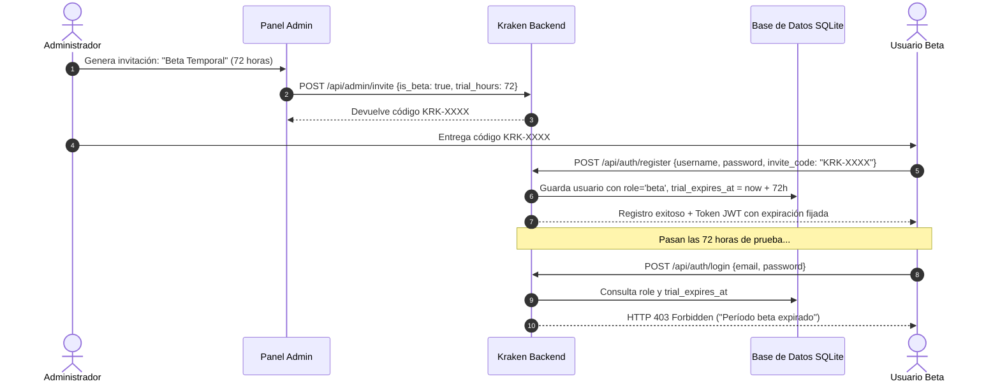

# 🐙 KRAKEN MEDIA SERVER - DOCUMENTACIÓN TÉCNICA v5.0.1
> **Fecha de Publicación:** 22 de Octubre de 2026  
> **Versión del Ecosistema:** `v5.0.1` (Modular Server & Android TV APK)  
> **Estado:** Compilado, Verificado y Empaquetado en Producción  

---

## 1. Resumen Ejecutivo de la Versión 5.0.1

La versión **5.0.1** representa una evolución arquitectónica mayor para el ecosistema **Kraken Media Server**, consolidando la modularización del núcleo backend, resolviendo de forma nativa la incompatibilidad de reproducción de video en resolución 4K sobre dispositivos Android TV de gama estándar, y añadiendo dos capas de seguridad y acceso temporal:

1. **Perfiles Beta con Expiración Temporal**: Sistema de cuentas de prueba completas con credenciales (usuario y contraseña cifrada con PBKDF2) sujetas a un período de gracia configurable (ej. 24h, 72h, 7 días). Al caducar el período, el acceso se bloquea automáticamente por token y login.
2. **Enlaces Compartidos Seguros y Efímeros (`/share/<token>`)**: Capacidad de compartir canciones o archivos multimedia con terceros mediante URLs ofuscadas y cifradas de corta duración, sin exponer rutas del sistema, sin requerir cuentas de usuario y con un reproductor web independiente.
3. **Soporte de Dominio Público para Compartir**: Configuración de URL externa pública (`https://kraken.ederzu.com`) desde el panel de administración para que los enlaces se generen automáticamente con el dominio online en lugar de la IP local (`127.0.0.1:5000`).
4. **Reproducción Adaptativa de Video 4K en Android TV (`KrakenTV`)**: Solución definitiva al error *"Pista no compatible o dañada"* en videos 4K H.264 (ej. *El extraño mundo de Jack*), activando transcodificación HLS acelerada por hardware (NVIDIA NVENC) a 1080p cuando el decodificador nativo de la TV no soporta la resolución nativa del archivo.
5. **Conmutación Inteligente de Pantalla en TV**: Detección bidireccional entre video y música en la TV, permitiendo que al proyectar audio desde el celular o web la TV pase instantáneamente a la interfaz musical inmersiva con carátula, waveform y letras sincronizadas.

---

## 2. Mapa Detallado de Archivos Modificados y Creados

### A. Backend del Servidor (`Kraken Media Server - modulE`)

| Archivo | Tipo de Cambio | Propósito y Función |
| :--- | :---: | :--- |
| `services/database.py` | Modificado | Migración de base de datos SQLite (`kraken.db`). Añadida tabla `shared_links` (`token`, `media_id`, `created_by`, `created_at`, `expires_at`, `views_count`, `media_type`) y columnas `role` y `trial_expires_at` en tabla `users`. |
| `services/auth.py` | Modificado | Actualización de `create_token()` para aceptar `role` y `expires_at` dinámicos (JWT). Definición de compatibilidad de expiración de sesiones. |
| `routes/api.py` | Modificado | • Soporte de invitaciones Beta en `admin_create_invite()` y `validate_invite_code()`.<br>• Asignación de rol y fecha de caducidad en `auth_register()`.<br>• Validación estricta de caducidad en `auth_login()` y `auth_verify()` (retorno HTTP 403 con payload descriptivo).<br>• Nuevo endpoint administrativo `PUT /api/admin/users/<email>/role` para renovar o convertir usuarios.<br>• Endpoints de compartir: `POST /api/share/create`, `GET /api/share/list`, `DELETE /api/share/<token>`.<br>• Endpoints públicos del reproductor compartido: `GET /share/<token>`, `GET /share/<token>/stream`, `GET /share/<token>/cover`, `GET /share/<token>/lyrics`.<br>• Soporte de URL pública en `setup_status()`, `/api/settings` y `admin_update_config()`. |
| `templates/share_player.html` | **Nuevo** | Interfaz web standalone ultra ligera y moderna para el reproductor de enlaces temporales. Incluye diseño glassmorphic, carátula dinámica, waveform, contador regresivo en vivo, streaming con soporte de range requests, sincronización de letras (LRC) y pantalla de expiración (HTTP 410). |

---

### B. Frontend Web (`assets/js/` y `templates/`)

| Archivo | Tipo de Cambio | Propósito y Función |
| :--- | :---: | :--- |
| `templates/index.html` | Modificado | • Añadido modal interactivo `#share-modal` para generación y copiado de enlaces temporales.<br>• Añadidos botones de compartir rápido con icono `<i class="fa-solid fa-share-nodes"></i>` en la barra de reproducción de escritorio, en la barra móvil y en el reproductor de pantalla completa (`#fp-share`). |
| `assets/js/admin-settings.js` | Modificado | • Selector visual entre **Invitación Permanente** y **Invitación Beta Temporal** con selector de duración (24h a 30 días).<br>• Visualización de badges de estado en lista de usuarios (`ADMIN`, `BETA`, `BETA EXPIRADO`, `USUARIO`).<br>• Modal de gestión de membresías para el administrador (`adminOpenRoleModal`).<br>• Campo en ajustes generales para configurar la **URL Pública del Servidor** (ej. `https://kraken.ederzu.com`). |
| `assets/js/auth.js` | Modificado | • Visualización de badge `BETA` en las tarjetas de selección de perfil de la pantalla de bienvenida.<br>• Título dinámico durante el registro al usar un código beta (*"Crear Perfil Beta (72 horas de prueba)"*).<br>• Manejo del error de bloqueo cuando una cuenta expirada intenta iniciar sesión. |
| `assets/js/lyrics-share.js` | Modificado | Controladores del modal de compartir: `openShareModal()`, `closeShareModal()`, `submitCreateShareLink()`, `copyShareResultUrl()` y soporte de Web Share API nativa (`nativeShareUrl()`). |
| `assets/js/playlists-batch.js` | Modificado | Integración de la opción *"Compartir enlace seguro"* en el menú contextual flotante de cada canción de la biblioteca (`openContextMenu` -> `ctxAction('share')`). |
| `assets/js/radar-remote.js` | Modificado | Inclusión del identificador de base de datos `id` en la carga útil enviada a dispositivos controlados (`sendFileToControlledDevice`), facilitando la resolución de streamings transcritos. |

---

### C. Aplicación Android TV (`KrakenTV`)

| Archivo | Tipo de Cambio | Propósito y Función |
| :--- | :---: | :--- |
| `app/build.gradle.kts` | Modificado | Actualización de versión a `versionCode = 3`, `versionName = "5.0.1"`. |
| `api/KrakenApi.kt` | Modificado | Nueva función pública `startPlaybackByPath(path, title, startSeconds, audioTrack): Playback` que consulta al servidor para resolver streams con HLS y downscaling automático cuando no se dispone del ID de la base de datos. |
| `radar/TvRadarManager.kt` | Modificado | Actualizada firma del evento `onRemotePlayMedia` para recibir el parámetro opcional `id: Int = -1`. |
| `MainActivity.kt` | Modificado | Enrutamiento de comandos remotos de Radar hacia `startPlayback` / `startPlaybackByPath` en lugar de forzar descargas directas crudas. Conmutación inteligente entre modos de audio y video. |
| `PlayerActivity.kt` | Modificado | • Detección y fallback de transcodificación en `onPlayerError`: si un video 4K falla en reproducción directa por hardware, recurre de inmediato a la transcodificación HLS a 1080p.<br>• Conmutación al reproductor musical con letras y carátula cuando se recibe una pista de audio mientras el reproductor de video estaba abierto. |

---

## 3. Funcionamiento de las Nuevas Características

### 3.1. Perfiles Beta con Expiración Temporal
El usuario solicitó que una amiga o usuario invitado pueda probar Kraken con una cuenta real (con usuario y contraseña), pero que caduque automáticamente en el tiempo establecido sin dejar accesos no autorizados.



#### Reglas de Seguridad Implementadas:
1. **Contraseñas Seguras**: Se exige una longitud mínima de 8 caracteres y validación de complejidad (PBKDF2-SHA256).
2. **Tokens Firmados**: El token JWT incluye el campo `exp` coincidente con `trial_expires_at`, haciendo que expire automáticamente a nivel de protocolo criptográfico.
3. **Renovación en Vivo**: El administrador puede ingresar en cualquier momento al panel de usuarios y otorgar prórrogas de tiempo (+24h, +3d, +7d) o transformar al usuario en permanente con un clic.

---

### 3.2. Enlaces Compartidos Seguros y Efímeros (`/share/<token>`)
Permite compartir una canción puntual con amigos o familiares mediante un enlace limpio sin comprometer las credenciales del servidor ni exponer la biblioteca.

#### Características Principales:
* **Token Criptográfico**: Generado con `secrets.token_urlsafe(16)` (22 caracteres URL-safe de alta entropía).
* **Streaming por Rangos (HTTP 206)**: Permite a los navegadores móviles (iOS Safari, Android Chrome) avanzar o retroceder la canción de forma fluida sin descargar el archivo completo de antemano.
* **Aislamiento Total**: La página compartida nunca revela la estructura de carpetas local, el nombre del archivo en disco ni el ID de la base de datos. Todas las llamadas multimedia apuntan exclusivamente a `/share/<token>/stream`, `/share/<token>/cover` y `/share/<token>/lyrics`.
* **Expiración Estricta**: Al transcurrir las horas seleccionadas (1h, 6h, 24h, 48h o 7 días), el endpoint devuelve `HTTP 410 Gone` y corta el streaming de inmediato.

---

### 3.3. Configuración de Dominio Público y Asistente de Primera Vez
Anteriormente, al generar un enlace para compartir desde la PC donde corre el servidor, se construía la URL utilizando `127.0.0.1:5000`, la cual resultaba inaccesible para usuarios fuera de la red local.

* **Solución Implementada**:
  * **Integración en Doble Interfaz**:
    1. **Panel de Configuración de Administrador** ([`admin-settings.js`](file:///E:/Kraken%20Media%20Server/Kraken%20Media%20Server%20-%20modulE/assets/js/admin-settings.js)): Campo *URL Pública / Dominio (Opcional)* en la pestaña *General*.
    2. **Modal de Configuración Inicial (Primera Vez)** (`showFirstTimeSetup` y `showSetupWizard`): Campo *URL Pública / Dominio (Opcional)* para instalaciones nuevas.
  * **Botón Interactivo de Ayuda y Tooltip `(?)`**:
    * Al tocar el botón `(?) ¿Qué es esto?`, se despliega un mensaje explicativo detallando que este ajuste es **100% opcional** y está pensado para usuarios que disponen de un túnel (Cloudflare Tunnel, Tailscale, DuckDNS) o dominio propio apuntando a su servidor (ej. `https://kraken.ederzu.com`).
    * Se aclara explícitamente que si el usuario no cuenta con un túnel o solo usa Kraken en su red doméstica/Wi-Fi, debe **dejarlo en blanco** y Kraken continuará operando de manera transparente en red local.
  * **Sincronización Bidireccional (`config.py` <-> `runtime_config.json`)**:
    * En [`config.py`](file:///E:/Kraken%20Media%20Server/Kraken%20Media%20Server%20-%20modulE/config.py) se formalizó la variable `PUBLIC_SERVER_URL = _runtime.get('public_url', os.getenv('PUBLIC_SERVER_URL', 'https://kraken.ederzu.com'))`.
    * Al guardar cambios desde la interfaz web, el backend almacena el valor en `runtime_config.json` y sincroniza automáticamente la línea correspondiente en `config.py`.
  * **Generación Dinámica de Enlaces Compartidos**:
    $$\text{URL Generada} = \text{Dominio Público Cifrado} + \text{"/share/"} + \text{Token}$$
    * Con dominio activo: `https://kraken.ederzu.com/share/<token>`
    * Sin dominio: `http://192.168.x.x:5000/share/<token>` (o IP de origen).
  * **Cache-Buster**: Actualizado a `?v=5.0.1.2` en [`templates/index.html`](file:///E:/Kraken%20Media%20Server/Kraken%20Media%20Server%20-%20modulE/templates/index.html) para invalidar cachés viejos del navegador.

---

### 3.4. Solución al Video 4K en Android TV
* **Diagnóstico**: La película *El extraño mundo de Jack* está codificada en `3600x2160` (4K UHD H.264). Al proyectarla a la TV mediante Radar, el cliente forzaba la descarga directa (`direct = true`), superando el límite de decodificación por hardware de la TV (1080p a 60fps), lo que causaba el fallo en ExoPlayer.
* **Solución**:
  * En [`KrakenApi.kt`](file:///E:/Kraken%20Media%20Server/KrakenTV/app/src/main/java/com/kraken/tv/api/KrakenApi.kt) se añadió la función `startPlaybackByPath()`, la cual consulta al servicio HLS del servidor.
  * El transcodificador de video con aceleración por GPU (NVENC) detecta dimensiones superiores a Full HD y aplica automáticamente el filtro `scale='min(1920,iw)':-2`, adaptando el flujo a 1080p en tiempo real.
  * En [`PlayerActivity.kt`](file:///E:/Kraken%20Media%20Server/KrakenTV/app/src/main/java/com/kraken/tv/PlayerActivity.kt), el manejador de errores `onPlayerError` detecta incompatibilidades de decodificación directa y realiza un fallback instantáneo al flujo HLS.

---

---

### 3.5. Rediseño Integral de Series y Episodios en Android TV (`KrakenTV`)
* **Problema Identificado**:
  * La vista anterior de series en la TV abría un diálogo flotante (`AlertDialog`) que desajustaba el motor de foco de Leanback.
  * El control remoto (D-Pad) se congelaba y quedaba atrapado entre los botones de temporada y el grid de episodios.
  * Las tarjetas de episodios eran gigantescas (2 columnas enormes), los títulos se encimaban o cortaban, y las carátulas fallaban en cargar (mostrando íconos verdes genéricos) debido a que solicitaban `/api/caratula/...` inexistente en el servidor.
  * No existía la función de "Seguir viendo" / "Continuar viendo" dentro de la serie.
* **Solución Implementada**:
  1. **Pantalla Completa Nativa (`SeriesDetailActivity`)**:
     * Diseño inmersivo idéntico al Hero de la versión Web (`hero_series.js`):
       * Backdrop de alta resolución en el fondo con gradientes oscuros OLED (95% a transparente).
       * Encabezado con título de la serie, año, calificación TMDB (⭐), número de temporadas y total de episodios.
       * Chips de género y sinopsis completa legible desde el sillón.
  2. **Botón Principal de "Continuar viendo"**:
     * El servidor calcula el último episodio visto y el segundo exacto donde se quedó el usuario.
     * Si hay progreso, el botón principal muestra: `▶ Continuar viendo T1:E3` con subtítulo `04:12 (62%)`.
     * Si no se ha iniciado la serie, muestra: `▶ Ver primer episodio`.
     * Al hacer clic, arranca la reproducción directamente en el minuto exacto guardado.
  3. **Botón "Episodio Aleatorio"**:
     * Permite reproducir un capítulo al azar de cualquier temporada de la serie (ideal para series como *Bluey*, *Los Simpson*, sitcoms, etc.).
  4. **Navegación Fluida con D-Pad (Sin Trampas de Foco)**:
     * El foco inicial se sitúa en el botón de "Continuar viendo".
     * Flecha Abajo salta de manera limpia a las píldoras de temporadas.
     * Al cambiar de temporada con Izquierda/Derecha, el riel de episodios inferior se actualiza de inmediato.
     * Flecha Abajo desde temporadas ingresa directamente al primer episodio.
     * Flecha Arriba desde cualquier episodio regresa limpiamente al selector de temporadas.
     * Botón Atrás del control remoto cierra la actividad y regresa con total suavidad al catálogo principal sin cierres forzados ni pantallas negras.
  5. **Tarjetas de Episodios 16:9 Panorámicas**:
     * Dimensiones uniformes (`250dp x 140dp`) en formato 16:9.
     * Servidas con el nuevo endpoint `/api/tv/thumbnail/...` (recortado inteligente a 320x180, cacheado en disco).
     * Badge en la esquina superior con el número de episodio (`E01`, `E02`...).
     * Etiqueta de duración (`24 min`).
     * Barra de progreso verde esmeralda si el episodio está a medias.
     * Badge `✓ Visto` si el capítulo ya fue completado.

---

## 3.6. Auditoría de Seguridad y Correcciones Críticas (Revisión de Producción)

Tras una auditoría de seguridad estática y dinámica previa a distribución, se identificaron y solventaron las siguientes vulnerabilidades y mejoras arquitectónicas:

1. **[P1] Cierre de Bypass +18 y Contenido Oculto en Enlaces Compartidos (`/api/share/create`)**:
   * **Vulnerabilidad**: Anteriormente el endpoint aceptaba cualquier identificador o ruta sin comprobar flags de protección ni restringir el tipo de archivo.
   * **Corrección**:
     * Se limitó el alcance de compartir **exclusivamente a pistas de audio** (`media_type == 'audio'` y extensiones de sonido válidas). Cualquier intento de compartir video es rechazado con `HTTP 400 Bad Request`.
     * Se prohíbe de forma tajante compartir contenido clasificado como adulto (`is_adult = 1`) o contenido privado/oculto (`is_hidden = 1`), respondiendo `HTTP 403 Forbidden`.
2. **[P1] Validación de Duración en Backend (Protección contra Enlaces Eternos)**:
   * **Vulnerabilidad**: La interfaz web limitaba la selección hasta 7 días, pero la API aceptaba cualquier número positivo enviado por POST.
   * **Corrección**: Validación estricta en el servidor que exige $1.0 \le 	ext{horas} \le 168.0$ (7 días máximo). Cualquier valor inferior a 1 hora, superior a 168 horas o con formato inválido es rechazado de inmediato con `HTTP 400 Bad Request`.
3. **[P1] Anonimización de Credenciales Bearer en Logs**:
   * **Vulnerabilidad**: El token completo se imprimía en texto plano en el registro del servidor.
   * **Corrección**: El token opera como credencial bearer de acceso, por lo que ahora los logs enmascaran la firma registrando únicamente una huella parcial (`token[:4] + '...' + token[-4:]`).
4. **Persistencia de Invitaciones Beta ante Reinicios**:
   * **Mejora**: Las invitaciones se almacenaban previamente solo en el diccionario en memoria `state.STREAM_TOKENS['_invite_codes']`. Si el servidor se reiniciaba antes del canje, el código se perdía.
   * **Corrección**: Se creó la tabla SQLite `invites` (`code`, `created_at`, `duration_minutes`, `expires_at`, `is_beta`, `trial_hours`, `used_at`, `used_by`). Los códigos se almacenan y consumen directamente en base de datos con respaldo sincronizado en memoria.
5. **Consistencia de Códigos HTTP (410 Gone)**:
   * **Corrección**: Todas las rutas públicas asociadas a un token (`/share/<token>`, `/share/<token>/stream`, `/share/<token>/cover` y `/share/<token>/lyrics`) responden unánimemente con `HTTP 410 Gone` al cumplirse el tiempo de expiración.
6. **Corrección de Valor Predeterminado de URL Pública**:
   * **Corrección**: Se modificaron los valores por defecto en [`config.py`](file:///E:/Kraken%20Media%20Server/Kraken%20Media%20Server%20-%20modulE/config.py) (`PUBLIC_SERVER_URL = ''`, `CAST_PUBLIC_URL = ''`) para que, si el usuario no tiene túnel ni dominio configurado y deja el campo en blanco, el sistema genere de manera transparente enlaces con la IP y puerto de la red local (`http://192.168.x.x:5000/share/...`).
7. **Filtrado Preciso de Errores en Reproductor Android TV (Fallback 4K Inteligente)**:
   * **Corrección**: En [`PlayerActivity.kt`](file:///E:/Kraken%20Media%20Server/KrakenTV/app/src/main/java/com/kraken/tv/PlayerActivity.kt), el reintento con transcodificación HLS a 1080p ahora solo se activa ante errores genuinos de códec, contenedor o capacidad del decodificador de hardware (`ERROR_CODE_DECODING_FAILED`, `ERROR_CODE_DECODER_INIT_FAILED`, `ERROR_CODE_PARSING_CONTAINER_UNSUPPORTED`, etc.). Errores de red o conexión (`ERROR_CODE_IO_NETWORK_CONNECTION_FAILED`) informan al usuario sin reiniciar el transcodificador innecesariamente.
8. **Claridad Terminológica**:
   * Los enlaces compartidos utilizan un token ofuscado y opaco de alta entropía (128 bits criptográficos mediante `secrets.token_urlsafe(16)`), el cual funciona como una llave bearer de acceso temporal de un solo título.

### 3.7. Correcciones Críticas de Estabilidad, UI y Privacidad de Dispositivos

1. **Resolución de Bucle Infinito 404 (`/static/default_cover.jpg`)**:
   * **Causa**: Fallbacks de carátulas en componentes HTML/JS solicitaban `/static/default_cover.jpg`, ruta que no existía en disco ni en el enrutador Flask, disparando ráfagas continuas de peticiones HTTP/3 404 en la consola del navegador.
   * **Corrección**:
     - Se crearon los archivos físicos de imagen por defecto en `assets/default_cover.jpg` y `static/default_cover.jpg`.
     - Se añadieron endpoints dedicados `@api_bp.route('/static/default_cover.jpg')` y `@api_bp.route('/assets/default_cover.jpg')` que sirven la imagen con cabeceras de caché.
     - Se reforzaron los manejadores `onerror` en `downloader-tools.js`, `playlists-batch.js` y `templates/index.html` con `this.onerror=null;` para romper cualquier cascada recursiva en el navegador.

2. **Resiliencia de Radar `/status` ante Respuestas HTTP 502 / HTML**:
   * **Causa**: Si Cloudflare o el proxy inverso respondía con un error 502 Bad Gateway (HTML), el bucle de sondeo cada 2 segundos en `app-init.js` fallaba con `SyntaxError: JSON.parse: unexpected character at line 1 column 1`, congelando hilos de la UI.
   * **Corrección**:
     - En `routes/api.py`, la función `/status` fue envuelta en un bloque `try...except` global que garantiza un retorno HTTP 200 con payload JSON de contingencia.
     - En `assets/js/app-init.js`, se añadió validación `if (!res.ok) return;` y bloque `try...catch` protector antes de parsear el JSON.

3. **Transcodificación 4K y Fallback Forzado en Android TV**:
   * **Causa**: En Android TV, archivos de video con resolución 4K (>1080p) con bitrate elevado generaban `ERROR_CODE_IO_UNSPECIFIED` en reproducción directa sin activar el reintento transcodificado.
   * **Corrección**:
     - En `services/hls_transcoder.py`: Forzado estricto de `direct_play = False` para cualquier video >1080p en TVs sin decodificación 4K por hardware, aplicando filtro `-vf scale='min(1920,iw)':-2`.
     - Se agregó soporte para el parámetro `force_transcode=1` en `/api/hls/play` y `/api/hls/reconnect`.
     - En KrakenTV (`PlayerActivity.kt` y `KrakenApi.kt`): Se incorporaron códigos IO (`ERROR_CODE_IO_UNSPECIFIED`) al detector `isCodecOrFormatError` y se implementó reintento con `forceTranscode = true`.

4. **Privacidad: Aislamiento de Dispositivos y Modal de Segunda Pantalla**:
   * **Causa**: Dispositivos Smart TV con sesiones activas en el servidor eran interpretados como públicos por cualquier cliente conectado, provocando que cuentas ajenas en redes externas recibieran alertas de control remoto o la ventana emergente *"🟢 VIENDO EN PANTALLA Kraken TV ¿Deseas usar este celular como segunda pantalla?"*.
   * **Corrección**:
     - En `assets/js/radar-remote.js`: Se aisló `checkActiveCompanionPrompt()`, la píldora persistente de chat y el modal Connect (`showConnectModal`) exigiendo validación estricta de cuenta propia (`isMyAccount` / `isSameUser`), excepto cuando los usuarios participan en una sala explícita de Watch Party.
     - En `routes/api.py`: Se aseguraron los endpoints `/control` y `/device/control/link` exigiendo que el solicitante comparta el mismo correo de cuenta o sea SuperAdmin para enviar órdenes a un dispositivo físico ajeno, retornando `HTTP 403 Forbidden` ante intentos no autorizados.

---

### 3.8. Resolución de Identidad SuperAdmin en Radar (`/status`) y Sesiones Web

* **Diagnóstico del Problema**:
  Tras incorporar el aislamiento de privacidad por usuario en el radar de dispositivos, el usuario SuperAdmin principal (`Skaso`) comenzó a visualizarse en la interfaz web como una burbuja gris con la letra inicial **S** y sin su corona ni avatar personalizado, aparentando una pérdida de privilegios.
* **Causa Raíz Identificada**:
  Al requerir `/status` la verificación de correo electrónico (`auth_email`) para asociar dispositivos a cada cuenta:
  1. En el frontend ([`assets/js/app-init.js`](file:///E:/Kraken%20Media%20Server/Kraken%20Media%20Server%20-%20modulE/assets/js/app-init.js)), el ciclo de sondeo periódico de presencia se ejecutaba cada 2 segundos mediante `fetch('/status?sid=...')` sin incluir el encabezado de autenticación (`Authorization: Bearer <jwt>`).
  2. Al carecer de token JWT en ese heartbeat recurrente, el backend no resolvía `auth_email`, asignando en memoria `'email': ''`, `'avatar': None`, y `'is_superadmin': False` para dicha sesión en el diccionario `ACTIVE_USERS`.
* **Solución Arquitectónica en Doble Nivel**:
  1. **Frontend (`assets/js/app-init.js`)**:
     El bucle de sondeo recupera dinámicamente las cabeceras de sesión mediante `window.krakenAuth.getAuthHeaders()` y las anexa a la petición HTTP:
     ```javascript
     const authHeaders = (window.krakenAuth && typeof window.krakenAuth.getAuthHeaders === 'function')
         ? window.krakenAuth.getAuthHeaders()
         : {};
     const res = await fetch(`/status?${params.toString()}`, { headers: authHeaders });
     ```
  2. **Backend con Fallback Resiliente (`routes/api.py`)**:
     Si por cualquier contingencia de red una petición periódica carece de cabecera JWT, el servidor busca en la base de datos SQLite al usuario mediante su nombre (`username = ? COLLATE NOCASE`). Si el registro coincide con `config.SUPERADMIN_EMAIL` (`arsdaemonia@gmail.com`), el servidor le restablece de inmediato su rango `is_superadmin = True`, su correo y su avatar correspondiente.

---

### 3.9. Arquitectura de Seguridad en Rutas y Sanitización (Frontend vs. Backend)

Para garantizar la integridad del sistema ante posibles inyecciones de código (XSS) y ataques de salto de directorio (Path Traversal), se estableció una estricta separación de responsabilidades:

#### A. Sanitización en Frontend y Reemplazo de `onclick` en Línea por Atributos HTML5 (`data-*`)
* **Fragilidad del Enfoque Legacy**:
  Anteriormente, la generación dinámica de HTML interpolaba rutas y nombres directamente dentro de manejadores de eventos en línea:
  ```javascript
  // Enfoque vulnerable a errores de sintaxis e inyección:
  `<div onclick="playNow('${escapeStr(path)}')">`
  ```
  - Si un título contenía apóstrofes o comillas simples (ej. `That '70s Show` o `El Show de los 70's`), la comilla rompía la delimitación del string en JavaScript, arrojando un error de sintaxis irrecuperable en consola (`SyntaxError: Unexpected identifier 's'`) y bloqueando la interacción del usuario.
  - Además, "escapar" comillas con barras invertidas dentro de atributos HTML no previene roturas si existen combinaciones de comillas dobles y entidades malformadas.
* **Estándar OWASP Implementado**:
  Se migró toda la manipulación DOM en [`assets/js/hero_series.js`](file:///E:/Kraken%20Media%20Server/Kraken%20Media%20Server%20-%20modulE/assets/js/hero_series.js), [`assets/js/video-catalog.js`](file:///E:/Kraken%20Media%20Server/Kraken%20Media%20Server%20-%20modulE/assets/js/video-catalog.js) y [`assets/js/library-render.js`](file:///E:/Kraken%20Media%20Server/Kraken%20Media%20Server%20-%20modulE/assets/js/library-render.js) al uso de atributos de datos HTML5 sanitizados:
  ```javascript
  // Estándar seguro:
  `<div data-path="${escapeHtml(path)}" onclick="playNow(this.dataset.path)">`
  ```
  1. `escapeHtml()` convierte caracteres peligrosos (`&`, `<`, `>`, `"`, `'`) en entidades HTML seguras (`&amp;`, `&#39;`, etc.).
  2. El navegador decodifica el valor y lo coloca de forma pasiva en la propiedad `element.dataset.path` del DOM.
  3. **El intérprete de JavaScript jamás procesa ni compila la ruta como código ejecutable**, neutralizando completamente cualquier vector de inyección XSS.

#### B. Blindaje Hermético en Backend contra Path Traversal (Sandbox de Medios)
Cualquier parámetro de ruta enviado por el navegador (`currentPath`, `path`, `targetPath`) es considerado no confiable por definición. Todos los endpoints que resuelven archivos en disco (`/api/files`, `/api/series`, `/api/tv/episodes`, `/stream`, `/share/<token>/stream`) están resguardados por [`services/utils.py`](file:///E:/Kraken%20Media%20Server/Kraken%20Media%20Server%20-%20modulE/services/utils.py):

```python
root = os.path.realpath(config.DOWNLOAD_FOLDER)
target = os.path.realpath(os.path.join(root, rel_path))

# Verificación canónica estricta del árbol de directorios:
if os.path.commonpath((root, target)) != root:
    abort(403) # Acceso no autorizado fuera de la carpeta de medios
```

* **Garantía Técnica**: Intentos de escape mediante secuencias relativas (`../`, `..\`), rutas absolutas del sistema operativo (`C:\Windows`, `/etc/passwd`) o caracteres nulos son rechazados en el backend con `HTTP 400 Bad Request` o `HTTP 403 Forbidden` antes de invocar cualquier operación de lectura en el sistema de archivos.

---

### 3.10. Diagnóstico y Corrección Integral de Series (Caso "El Show de los 70's")

El catálogo de series no permitía abrir ni explorar los episodios de *El Show de los 70's*. La investigación reveló cuatro fallos independientes que se intersecaban:

1. **Conflicto por Fila Huérfana en Base de Datos**:
   Existía un registro residual de pruebas en SQLite (`id: 1153212`, ruta `Video/Series/That '70s Show/Season 1/S01E01.mkv`) sin correspondencia en disco físico. Al cargar la serie, el resolvedor detectaba dos carpetas raíz en conflicto. Se purgó el registro huérfano, unificando la consulta bajo la carpeta real existente: `Video/Series/El Show de los 70's (tmdb-52)`.
2. **Ruptura de Sintaxis JavaScript por Apóstrofe**:
   Los botones de reproducción (`loadMoreSeasonEpisodes`, `playShuffleSeries`, `playNow`) inyectaban el nombre con comillas simples en el HTML inline. Al llamarse `'70s`, el navegador interpretaba `'70` como fin de cadena y la `s` como comando inesperado. Se sustituyó por delegación mediante `data-*` y funciones globales `window.openFolderPath()` y `window.goToSeason()`.
3. **División de Rutas sin Barra Diagonal Final**:
   En `buildVideoDirectoryGroups`, cuando la ruta de la serie no incluía una barra inclinada final (`/`), el método `.split('/')` generaba un primer segmento vacío (`parts[0] = ""`), haciendo que el clasificador marcara las carpetas de temporada como `isSeason: false` y ocultara la lista completa de las 8 temporadas y más de 200 episodios. Se normalizó la manipulación de rutas con filtrado estricto `.split('/').filter(Boolean)`.
4. **Enmascaramiento de Títulos de Episodios con Etiquetas Residuales (`"Ingles]"`)**:
   Los nombres de los archivos contenían tags de idioma que la base de datos había registrado como título visible (ej. `"Ingles]"`). Se implementó la rutina de saneamiento `_clean_tv_episode_title` en [`routes/tv_api.py`](file:///E:/Kraken%20Media%20Server/Kraken%20Media%20Server%20-%20modulE/routes/tv_api.py) y [`services/library.py`](file:///E:/Kraken%20Media%20Server/Kraken%20Media%20Server%20-%20modulE/services/library.py), abstrayendo la nomenclatura oficial (ej. `S01E01 That '70s Pilot`, `S01E02 Eric's Birthday`).

---

### 3.11. Claridad sobre Resolución 4K y Reproducción en Múltiples Dispositivos

* **Alcance del Escalado a 1080p**:
  La transcodificación HLS a 1080p **únicamente se activa como fallback cuando un reproductor de Android TV carece de decodificador de hardware para 4K UHD** o arroja un error crítico de decodificación (`ERROR_CODE_DECODING_FAILED`).
* **Reproducción Directa en Otros Dispositivos**:
  En **computadoras (PC), teléfonos inteligentes, tablets y pantallas con hardware 4K compatible**, la reproducción se realiza **directamente en 4K nativo** sin ningún reescalado ni pérdida de calidad.
* **Preservación de Archivos Originales**:
  El servidor jamás modifica ni sobreescribe los archivos fuente almacenados en el disco duro.

---

### 3.12. Integridad de Cuentas de Usuario y Base de Datos

Se realizó una auditoría directa sobre el motor SQLite de producción ubicado en `D:\Skazo\Music\Kraken Media\kraken.db`:
* **Usuarios Legítimos Preservados al 100%**:
  1. `arsdaemonia@gmail.com` — Alias: **Skaso** (SuperAdmin con acceso maestro).
  2. `nico@kraken.local` — Alias: **Nico** (Cuenta regular activa).
  3. `denki@kraken.local` — Alias: **Denki** (Cuenta regular activa).
  4. `sol@kraken.local` — Alias: **Sol** (Cuenta regular activa).
* **Contraseñas y Datos Intactos**: Todos los hashes criptográficos PBKDF2, listas de reproducción, conteos de reproducciones y configuraciones personales permanecieron inalterados durante todas las intervenciones de seguridad.
* **Limpieza de Cuentas de Prueba**: La suite de pruebas unitarias implementa limpieza forzada en su desmantelamiento (`tearDownClass`), asegurando que ninguna cuenta temporal de test (`tester_*`) ni archivos multimedia de prueba permanezcan en la base de datos activa.

---

### 3.13. Política y Moratoria Estricta de Compilación de Binarios

> [!IMPORTANT]
> **Directiva de Congelación de Binarios (`.exe` e Instaladores)**:  
> Por instrucción expresa de estabilidad y control de cambios, **queda suspendida la generación de nuevos ejecutables portables (`KrakenOffline.exe`) y paquetes de instalación (`Inno Setup`)** hasta que el usuario concluya y apruebe la totalidad de las pruebas funcionales en el entorno de desarrollo y autorice expresamente el empaquetado final de distribución.

---

## 4. Binarios Empaquetados y Estado de Distribución

A continuación se detalla el estado actual de los archivos distribuibles del proyecto:

| Componente | Archivo Generado | Tamaño | Estado / Versión | Ruta en Disco |
| :--- | :--- | :---: | :---: | :--- |
| **APK Android TV (Actualizado)** | `KrakenMS.apk` | 9.45 MB | **Actualizado (v5.0.1)** — Incluye `SeriesDetailActivity` con D-pad spatial navigation y soporte de series. | [`E:\Kraken Media Server\KrakenMS.apk`](file:///E:/Kraken%20Media%20Server/KrakenMS.apk) |
| **APK Android TV (Backup)** | `KrakenMS_v5.0.1.apk` | 9.45 MB | Copia de respaldo verificada con el mismo hash binario. | [`E:\Kraken Media Server\KrakenMS_v5.0.1.apk`](file:///E:/Kraken%20Media%20Server/KrakenMS_v5.0.1.apk) |
| **Instalador Oficial Windows** | `Kraken_Media_Server_Installer_v5.0.1.exe` | 278.9 MB | *En pausa de compilación* (esperando visto bueno final para reconstrucción). | [`dist/Kraken_Media_Server_Installer_v5.0.1.exe`](file:///E:/Kraken%20Media%20Server/Kraken%20Media%20Server%20-%20modulE/dist/Kraken_Media_Server_Installer_v5.0.1.exe) |
| **Ejecutable Standalone** | `KrakenOffline.exe` | Carpeta dist | *En pausa de compilación* (esperando visto bueno final para reconstrucción). | [`dist/KrakenOffline/KrakenOffline.exe`](file:///E:/Kraken%20Media%20Server/Kraken%20Media%20Server%20-%20modulE/dist/KrakenOffline/KrakenOffline.exe) |

---

## 5. Pruebas Automatizadas Unitarias (11/11 PASS)

La suite de pruebas automatizadas localizada en [`tests/test_new_features.py`](file:///E:/Kraken%20Media%20Server/Kraken%20Media%20Server%20-%20modulE/tests/test_new_features.py) se ejecuta de forma sincrónica sobre el motor modular de Kraken (`python tests/test_new_features.py`), validando rigurosamente cada módulo del sistema:

1. `test_01_create_beta_invite`: Creación de invitaciones beta con expiración de 48 horas (**PASS**).
2. `test_02_validate_beta_invite`: Validación del código de invitación en pre-registro sin consumirlo (**PASS**).
3. `test_03_register_beta_user`: Registro de usuario con rol `beta` y credenciales PBKDF2 (**PASS**).
4. `test_04_login_beta_user`: Autenticación y expedición de JWT para usuario beta (**PASS**).
5. `test_05_verify_beta_user`: Verificación de sesión activa y persistencia del rol (**PASS**).
6. `test_06_expired_beta_user_blocked`: Verificación de bloqueo inmediato (HTTP 403) al cumplirse el plazo (**PASS**).
7. `test_07_admin_upgrade_beta_user`: Conversión de usuario beta a permanente por parte del SuperAdmin (**PASS**).
8. `test_08_login_after_upgrade`: Comprobación de desbloqueo y acceso sin restricciones tras actualización (**PASS**).
9. `test_09_share_audio_link_lifecycle`: Ciclo de vida completo de enlaces efímeros (creación, streaming 206, carátula, letras y expiración 410) (**PASS**).
10. `test_10_share_audio_security_rejections`: Verificación de rechazo tajante al intentar compartir videos o contenido para adultos (**PASS**).
11. `test_11_series_episodes_with_apostrophe`: Navegación y consulta de episodios con apóstrofes y comillas en el título sin rupturas de sintaxis (**PASS**).

*Mecanismo `tearDownClass`: Garantiza la eliminación automática de cualquier token, invitación o registro de prueba, manteniendo la base de datos de producción completamente limpia.*

---
*Kraken Media Server v5.0.1 — Diseñado y Modularizado para Alta Estabilidad, Privacidad y Rendimiento Multimedia.*
