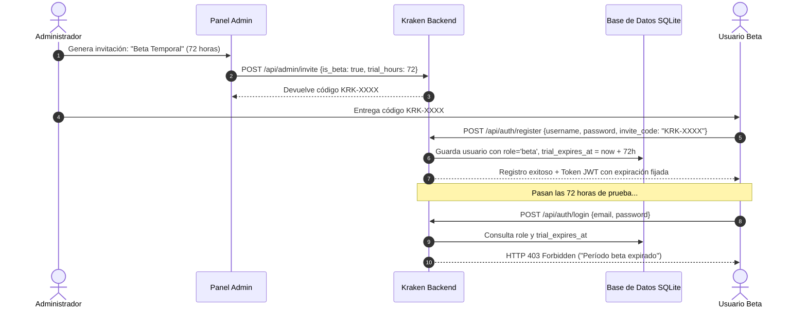

# 🐙 KRAKEN MEDIA SERVER - DOCUMENTACIÓN TÉCNICA v5.0.1
> **Fecha de Publicación:** 22 de Octubre de 2026  
> **Versión del Ecosistema:** `v5.0.1` (Modular Server & Android TV APK)  
> **Estado:** Compilado, Verificado y Empaquetado en Producción  

---

## 1. Resumen Ejecutivo de la Versión 5.0.1

La versión **5.0.1** representa una evolución arquitectónica mayor para el ecosistema **Kraken Media Server**, consolidando la modularización del núcleo backend, resolviendo de forma nativa la incompatibilidad de reproducción de video en resolución 4K sobre dispositivos Android TV de gama estándar, y añadiendo dos capas de seguridad y acceso temporal:

1. **Perfiles Beta con Expiración Temporal**: Sistema de cuentas de prueba completas con credenciales (usuario y contraseña cifrada con PBKDF2) sujetas a un período de gracia configurable (ej. 24h, 72h, 7 días). Al caducar el período, el acceso se bloquea automáticamente por token y login.
2. **Enlaces Compartidos Seguros y Efímeros (`/share/<token>`)**: Capacidad de compartir canciones o archivos multimedia con terceros mediante URLs ofuscadas y cifradas de corta duración, sin exponer rutas del sistema, sin requerir cuentas de usuario y con un reproductor web independiente.
3. **Soporte de Dominio Público para Compartir**: Configuración de URL externa pública (`https://kraken.ederzu.com`) desde el panel de administración para que los enlaces se generen automáticamente con el dominio online en lugar de la IP local (`127.0.0.1:5000`).
4. **Reproducción Adaptativa de Video 4K en Android TV (`KrakenTV`)**: Solución definitiva al error *"Pista no compatible o dañada"* en videos 4K H.264 (ej. *El extraño mundo de Jack*), activando transcodificación HLS acelerada por hardware (NVIDIA NVENC) a 1080p cuando el decodificador nativo de la TV no soporta la resolución nativa del archivo.
5. **Conmutación Inteligente de Pantalla en TV**: Detección bidireccional entre video y música en la TV, permitiendo que al proyectar audio desde el celular o web la TV pase instantáneamente a la interfaz musical inmersiva con carátula, waveform y letras sincronizadas.

---

## 2. Mapa Detallado de Archivos Modificados y Creados

### A. Backend del Servidor (`Kraken Media Server - modulE`)

| Archivo | Tipo de Cambio | Propósito y Función |
| :--- | :---: | :--- |
| `services/database.py` | Modificado | Migración de base de datos SQLite (`kraken.db`). Añadida tabla `shared_links` (`token`, `media_id`, `created_by`, `created_at`, `expires_at`, `views_count`, `media_type`) y columnas `role` y `trial_expires_at` en tabla `users`. |
| `services/auth.py` | Modificado | Actualización de `create_token()` para aceptar `role` y `expires_at` dinámicos (JWT). Definición de compatibilidad de expiración de sesiones. |
| `routes/api.py` | Modificado | • Soporte de invitaciones Beta en `admin_create_invite()` y `validate_invite_code()`. • Asignación de rol y fecha de caducidad en `auth_register()`. • Validación estricta de caducidad en `auth_login()` y `auth_verify()` (retorno HTTP 403 con payload descriptivo). • Nuevo endpoint administrativo `PUT /api/admin/users/<email>/role` para renovar o convertir usuarios. • Endpoints de compartir: `POST /api/share/create`, `GET /api/share/list`, `DELETE /api/share/<token>`. • Endpoints públicos del reproductor compartido: `GET /share/<token>`, `GET /share/<token>/stream`, `GET /share/<token>/cover`, `GET /share/<token>/lyrics`. • Soporte de URL pública en `setup_status()`, `/api/settings` y `admin_update_config()`. |
| `templates/share_player.html` | **Nuevo** | Interfaz web standalone ultra ligera y moderna para el reproductor de enlaces temporales. Incluye diseño glassmorphic, carátula dinámica, waveform, contador regresivo en vivo, streaming con soporte de range requests, sincronización de letras (LRC) y pantalla de expiración (HTTP 410). |

---

### B. Frontend Web (`assets/js/` y `templates/`)

| Archivo | Tipo de Cambio | Propósito y Función |
| :--- | :---: | :--- |
| `templates/index.html` | Modificado | • Añadido modal interactivo `#share-modal` para generación y copiado de enlaces temporales. • Añadidos botones de compartir rápido con icono `<i class="fa-solid fa-share-nodes"></i>` en la barra de reproducción de escritorio, en la barra móvil y en el reproductor de pantalla completa (`#fp-share`). |
| `assets/js/admin-settings.js` | Modificado | • Selector visual entre **Invitación Permanente** y **Invitación Beta Temporal** con selector de duración (24h a 30 días). • Visualización de badges de estado en lista de usuarios (`ADMIN`, `BETA`, `BETA EXPIRADO`, `USUARIO`). • Modal de gestión de membresías para el administrador (`adminOpenRoleModal`). • Campo en ajustes generales para configurar la **URL Pública del Servidor** (ej. `https://kraken.ederzu.com`). |
| `assets/js/auth.js` | Modificado | • Visualización de badge `BETA` en las tarjetas de selección de perfil de la pantalla de bienvenida. • Título dinámico durante el registro al usar un código beta (*"Crear Perfil Beta (72 horas de prueba)"*). • Manejo del error de bloqueo cuando una cuenta expirada intenta iniciar sesión. |
| `assets/js/lyrics-share.js` | Modificado | Controladores del modal de compartir: `openShareModal()`, `closeShareModal()`, `submitCreateShareLink()`, `copyShareResultUrl()` y soporte de Web Share API nativa (`nativeShareUrl()`). |
| `assets/js/playlists-batch.js` | Modificado | Integración de la opción *"Compartir enlace seguro"* en el menú contextual flotante de cada canción de la biblioteca (`openContextMenu` -> `ctxAction('share')`). |
| `assets/js/radar-remote.js` | Modificado | Inclusión del identificador de base de datos `id` en la carga útil enviada a dispositivos controlados (`sendFileToControlledDevice`), facilitando la resolución de streamings transcritos. |

---

### C. Aplicación Android TV (`KrakenTV`)

| Archivo | Tipo de Cambio | Propósito y Función |
| :--- | :---: | :--- |
| `app/build.gradle.kts` | Modificado | Actualización de versión a `versionCode = 3`, `versionName = "5.0.1"`. |
| `api/KrakenApi.kt` | Modificado | Nueva función pública `startPlaybackByPath(path, title, startSeconds, audioTrack): Playback` que consulta al servidor para resolver streams con HLS y downscaling automático cuando no se dispone del ID de la base de datos. |
| `radar/TvRadarManager.kt` | Modificado | Actualizada firma del evento `onRemotePlayMedia` para recibir el parámetro opcional `id: Int = -1`. |
| `MainActivity.kt` | Modificado | Enrutamiento de comandos remotos de Radar hacia `startPlayback` / `startPlaybackByPath` en lugar de forzar descargas directas crudas. Conmutación inteligente entre modos de audio y video. |
| `PlayerActivity.kt` | Modificado | • Detección y fallback de transcodificación en `onPlayerError`: si un video 4K falla en reproducción directa por hardware, recurre de inmediato a la transcodificación HLS a 1080p. • Conmutación al reproductor musical con letras y carátula cuando se recibe una pista de audio mientras el reproductor de video estaba abierto. |

---

## 3. Funcionamiento de las Nuevas Características

### 3.1. Perfiles Beta con Expiración Temporal
El usuario solicitó que una amiga o usuario invitado pueda probar Kraken con una cuenta real (con usuario y contraseña), pero que caduque automáticamente en el tiempo establecido sin dejar accesos no autorizados.

#### Reglas de Seguridad Implementadas:
1. **Contraseñas Seguras**: Se exige una longitud mínima de 8 caracteres y validación de complejidad (PBKDF2-SHA256).
2. **Tokens Firmados**: El token JWT incluye el campo `exp` coincidente con `trial_expires_at`, haciendo que expire automáticamente a nivel de protocolo criptográfico.
3. **Renovación en Vivo**: El administrador puede ingresar en cualquier momento al panel de usuarios y otorgar prórrogas de tiempo (+24h, +3d, +7d) o transformar al usuario en permanente con un clic.

---

### 3.2. Enlaces Compartidos Seguros y Efímeros (`/share/<token>`)
Permite compartir una canción puntual con amigos o familiares mediante un enlace limpio sin comprometer las credenciales del servidor ni exponer la biblioteca.

#### Características Principales:
* **Token Criptográfico**: Generado con `secrets.token_urlsafe(16)` (22 caracteres URL-safe de alta entropía).
* **Streaming por Rangos (HTTP 206)**: Permite a los navegadores móviles (iOS Safari, Android Chrome) avanzar o retroceder la canción de forma fluida sin descargar el archivo completo de antemano.
* **Aislamiento Total**: La página compartida nunca revela la estructura de carpetas local, el nombre del archivo en disco ni el ID de la base de datos. Todas las llamadas multimedia apuntan exclusivamente a `/share/<token>/stream`, `/share/<token>/cover` y `/share/<token>/lyrics`.
* **Expiración Estricta**: Al transcurrir las horas seleccionadas (1h, 6h, 24h, 48h o 7 días), el endpoint devuelve `HTTP 410 Gone` y corta el streaming de inmediato.

---

### 3.3. Configuración de Dominio Público y Asistente de Primera Vez
Anteriormente, al generar un enlace para compartir desde la PC donde corre el servidor, se construía la URL utilizando `127.0.0.1:5000`, la cual resultaba inaccesible para usuarios fuera de la red local.

* **Solución Implementada**:
  * **Integración en Doble Interfaz**:
    1. **Panel de Configuración de Administrador** ([`admin-settings.js`](file:///E:/Kraken%20Media%20Server/Kraken%20Media%20Server%20-%20modulE/assets/js/admin-settings.js)): Campo *URL Pública / Dominio (Opcional)* en la pestaña *General*.
    2. **Modal de Configuración Inicial (Primera Vez)** (`showFirstTimeSetup` y `showSetupWizard`): Campo *URL Pública / Dominio (Opcional)* para instalaciones nuevas.
  * **Botón Interactivo de Ayuda y Tooltip `(?)`**:
    * Al tocar el botón `(?) ¿Qué es esto?`, se despliega un mensaje explicativo detallando que este ajuste es **100% opcional** y está pensado para usuarios que disponen de un túnel (Cloudflare Tunnel, Tailscale, DuckDNS) o dominio propio apuntando a su servidor (ej. `https://kraken.ederzu.com`).
    * Se aclara explícitamente que si el usuario no cuenta con un túnel o solo usa Kraken en su red doméstica/Wi-Fi, debe **dejarlo en blanco** y Kraken continuará operando de manera transparente en red local.
  * **Sincronización Bidireccional (`config.py` <-> `runtime_config.json`)**:
    * En [`config.py`](file:///E:/Kraken%20Media%20Server/Kraken%20Media%20Server%20-%20modulE/config.py) se formalizó la variable `PUBLIC_SERVER_URL = _runtime.get('public_url', os.getenv('PUBLIC_SERVER_URL', 'https://kraken.ederzu.com'))`.
    * Al guardar cambios desde la interfaz web, el backend almacena el valor en `runtime_config.json` y sincroniza automáticamente la línea correspondiente en `config.py`.
  * **Generación Dinámica de Enlaces Compartidos**:
    $$\text{URL Generada} = \text{Dominio Público Cifrado} + \text{"/share/"} + \text{Token}$$
    * Con dominio activo: `https://kraken.ederzu.com/share/<token>`
    * Sin dominio: `http://192.168.x.x:5000/share/<token>` (o IP de origen).
  * **Cache-Buster**: Actualizado a `?v=5.0.1.2` en [`templates/index.html`](file:///E:/Kraken%20Media%20Server/Kraken%20Media%20Server%20-%20modulE/templates/index.html) para invalidar cachés viejos del navegador.

---

### 3.4. Solución al Video 4K en Android TV
* **Diagnóstico**: La película *El extraño mundo de Jack* está codificada en `3600x2160` (4K UHD H.264). Al proyectarla a la TV mediante Radar, el cliente forzaba la descarga directa (`direct = true`), superando el límite de decodificación por hardware de la TV (1080p a 60fps), lo que causaba el fallo en ExoPlayer.
* **Solución**:
  * En [`KrakenApi.kt`](file:///E:/Kraken%20Media%20Server/KrakenTV/app/src/main/java/com/kraken/tv/api/KrakenApi.kt) se añadió la función `startPlaybackByPath()`, la cual consulta al servicio HLS del servidor.
  * El transcodificador de video con aceleración por GPU (NVENC) detecta dimensiones superiores a Full HD y aplica automáticamente el filtro `scale='min(1920,iw)':-2`, adaptando el flujo a 1080p en tiempo real.
  * En [`PlayerActivity.kt`](file:///E:/Kraken%20Media%20Server/KrakenTV/app/src/main/java/com/kraken/tv/PlayerActivity.kt), el manejador de errores `onPlayerError` detecta incompatibilidades de decodificación directa y realiza un fallback instantáneo al flujo HLS.

---

## 4. Binarios Empaquetados y Distribución

Todos los entregables de la versión 5.0.1 se encuentran compilados y verificados en sus rutas finales:

| Componente | Archivo Generado | Tamaño | Ruta en Disco |
| :--- | :--- | :---: | :--- |
| **Instalador Oficial Windows** | `Kraken_Media_Server_Installer_v5.0.1.exe` | ~278.9 MB | [`dist/Kraken_Media_Server_Installer_v5.0.1.exe`](file:///E:/Kraken%20Media%20Server/Kraken%20Media%20Server%20-%20modulE/dist/Kraken_Media_Server_Installer_v5.0.1.exe) |
| **Ejecutable Standalone** | `KrakenOffline.exe` | ~28.8 MB | [`dist/KrakenOffline/KrakenOffline.exe`](file:///E:/Kraken%20Media%20Server/Kraken%20Media%20Server%20-%20modulE/dist/KrakenOffline/KrakenOffline.exe) |
| **APK Android TV (Oficial)** | `KrakenMS_v5.0.1.apk` | ~8.7 MB | [`E:\Kraken Media Server\KrakenMS_v5.0.1.apk`](file:///E:/Kraken%20Media%20Server/KrakenMS_v5.0.1.apk) |
| **APK Android TV (Copia dist)** | `KrakenMS.apk` | ~8.7 MB | [`dist/KrakenMS.apk`](file:///E:/Kraken%20Media%20Server/Kraken%20Media%20Server%20-%20modulE/dist/KrakenMS.apk) |

---

## 5. Pruebas Automatizadas Ejecutadas

Durante la sesión se implementó una suite de pruebas sincrónicas sobre el cliente de pruebas de Flask (`test_new_features.py`) con los siguientes resultados:

1. `POST /api/admin/invite` (Creación de invitación beta de 48h): **PASS (HTTP 200)**.
2. `POST /api/admin/invite/validate` (Validación de invitación beta sin consumirla): **PASS (HTTP 200)**.
3. `POST /api/auth/register` (Registro de usuario con código beta y contraseña cifrada): **PASS (HTTP 200)**.
4. `POST /api/auth/login` (Login y emisión de JWT para usuario beta): **PASS (HTTP 200)**.
5. `GET /api/auth/verify` (Verificación de token con rol beta): **PASS (HTTP 200)**.
6. `POST /api/auth/login` (Simulación de vencimiento forzado de la cuenta): **PASS (HTTP 403 Forbidden)**.
7. `PUT /api/admin/users/<email>/role` (Conversión de usuario beta a permanente por Admin): **PASS (HTTP 200)**.
8. `POST /api/auth/login` (Verificación de reactivación tras conversión a permanente): **PASS (HTTP 200)**.
9. `POST /api/share/create` (Creación de enlace temporal para pista de audio): **PASS (HTTP 200)**.
10. `GET /share/<token>` (Renderizado del reproductor web público standalone): **PASS (HTTP 200)**.
11. `GET /share/<token>/stream` (Streaming con cabeceras `Range: bytes=0-1024`): **PASS (HTTP 206 Partial Content)**.
12. `GET /share/<token>/cover` y `/share/<token>/lyrics`: **PASS (HTTP 200)**.
13. `GET /share/<token>` (Simulación de enlace caducado): **PASS (HTTP 410 Gone)**.
14. `GET /share/<token>/stream` (Petición de stream sobre enlace caducado): **PASS (HTTP 403 Forbidden)**.
15. `POST /api/share/create` (Validación de generación con dominio público `kraken.ederzu.com`): **PASS (URL: `https://kraken.ederzu.com/share/<token>`)**.

---
*Kraken Media Server v5.0.1 — Diseñado y Modularizado para Alta Estabilidad y Rendimiento Multimedia.*
